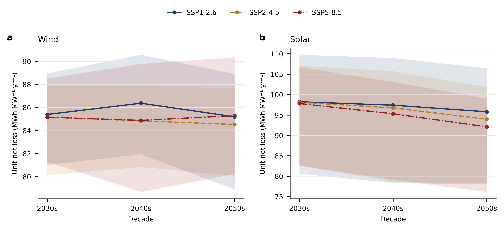
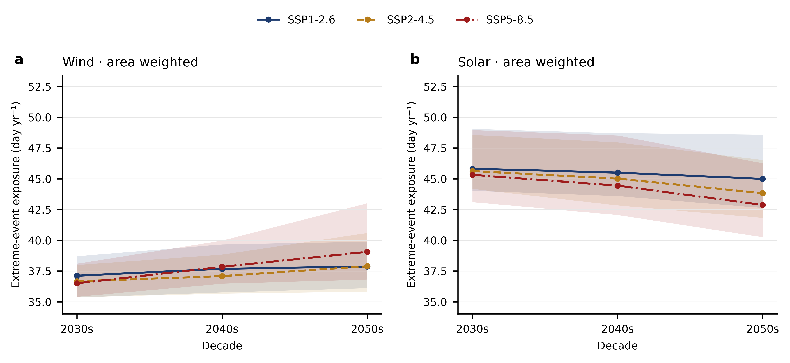
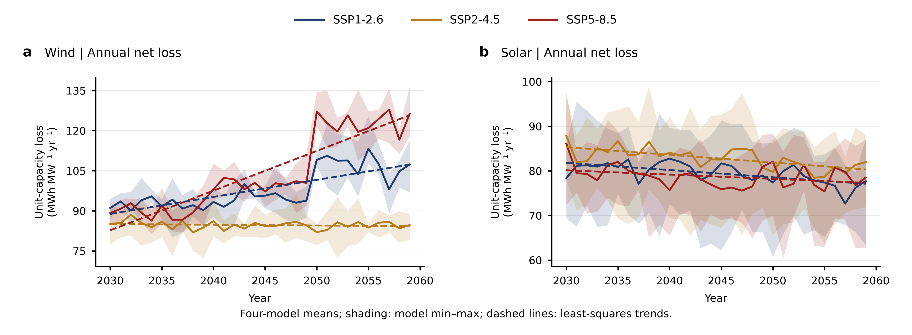
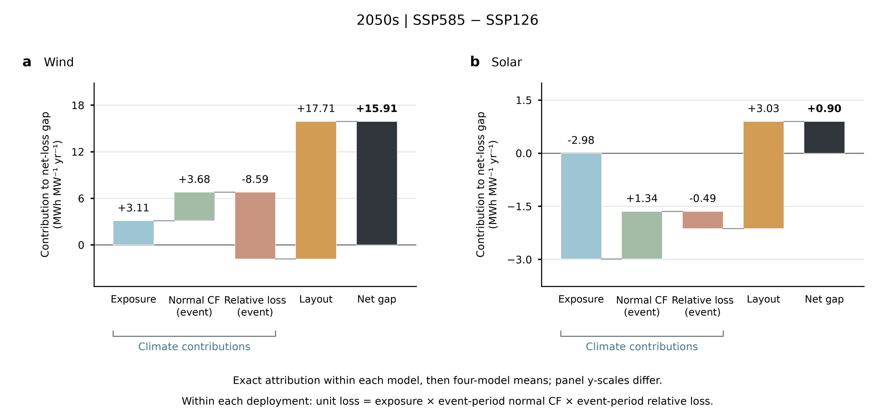
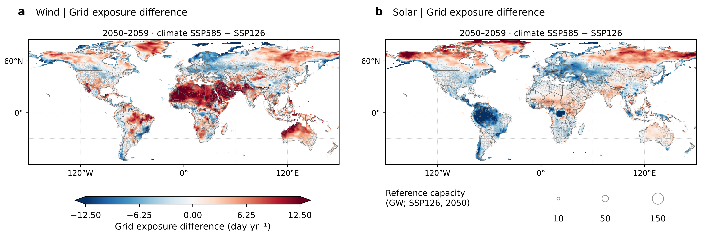
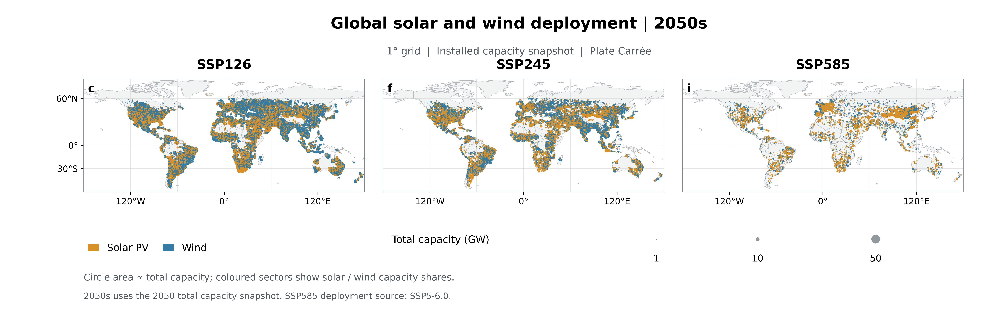

# SSP 对比三结论：气候信号、部署布局与损失的责任分离

claude code

整理日期：2026-11-02。数据来源：乌镇1866 仓库五类已验收结果（图1/图2 source_data、全球适宜网格损失与极端暴露补充图），本地分析快照在 `tmp/ssp_story/`。叙事逻辑参照 `ref_code/analysis_of_global_south_north/figure_story_20260910`（反直觉核心 → 机制分解 → 空间机制与出路）。

**单位约定**：损失均为单位装机净损失，MWh MW⁻¹ yr⁻¹；暴露为事件并集累计时长，day yr⁻¹（1 day = 24 h，非日历天数）。曲线为四模式（BCC-CSM2-MR、CANESM5、MPI-ESM1-2-HR、MRI-ESM2-0）等权均值，阴影为模式 min–max，非置信区间。

---

## 结论一（核心反直觉）：损失强度与变暖强度脱钩

**最绿的路径（SSP1-2.6）风电单位损失照样上升 16%；最暖的世界（SSP5-8.5）光伏单位损失反而最低。**

固定适宜网格（每格固定 1 MW，纯气候信号，无部署混杂）上：

| 单位装机损失（MWh MW⁻¹ yr⁻¹） | ssp126 | ssp245 | ssp585 |
|---|---:|---:|---:|
| 光伏 2030s → 2050s | 98.2 → 95.8（−2.5%） | 98.1 → 94.0（−4.2%） | 97.8 → 92.1（−5.8%） |
| 风电 2030s → 2050s | 85.4 → 85.2（−0.2%） | 85.2 → 84.5（−0.8%） | 85.2 → 85.3（+0.2%） |

- **风电**：三条 SSP 曲线几乎重合（2050s 三者最大差 0.8），纯气候信号对风电单位损失几乎无差别；但场站侧（气候 × 部署组合）126 上涨 16%、585 上涨 37%——损失在**每条路径**都上升，mitigated 世界并不更安全。
- **光伏**：损失随强迫升高而**下降**，2050s 排序 126 > 245 > 585（245 > 585 在 4/4 模式成立，126 > 585 在 3/4）。驱动是真实事件暴露的收缩：SSP5-8.5 下，2030s 至 2050s 的面积加权光伏高湿暴露 −1.29 day yr⁻¹、结冰 −0.65、冻雨 −0.55（下图中 585 柱整体低于 126/245）。

场站侧（路径本身）作为对照：

| 场站单位装机损失（MWh MW⁻¹ yr⁻¹） | ssp126 | ssp245 | ssp585 |
|---|---:|---:|---:|
| 光伏 2030s → 2050s | 80.6 → 77.6（−3.7%） | 84.5 → 80.7（−4.5%） | 80.2 → 78.5（−2.2%） |
| 风电 2030s → 2050s | 92.3 → 107.2（**+16.1%**） | 85.0 → 84.4（−0.7%） | 89.7 → 123.1（**+37.2%**） |

一句话版本：变暖强度不决定谁承受损失，路径才决定。由此逼出机制问题——场站与固定网格的差异从哪里来？

---

## 结论二（机制）：主导放大器是"建在哪"，不是"天气怎么变"

把场站损失变化分解为 ΔR = ΔR_气候（固定适宜网格项）+ ΔR_布局（残差，2030s → 2050s）：

| | Δ总变化 | Δ气候 | Δ布局 | 布局占比 |
|---|---:|---:|---:|---:|
| 风电 ssp126 | +14.9 | −0.2 | +15.1 | **101%** |
| 风电 ssp585 | +33.4 | +0.1 | +33.3 | **100%** |
| 光伏 ssp585 | −1.8 | −5.7 | +4.0 | 抵消气候红利的 **70%** |

- **风电损失增量的 ≈100% 来自部署布局，气候项 ≈ 0。** 585−126 风电差（2050s +15.9 MWh MW⁻¹ yr⁻¹）的瀑布分解中，layout 项 +17.7（4/4 模式，范围 14.6–23.0），气候三因子合计 ≈ 0 甚至 3/4 模式为负：气候本身若无其事，选址把损失推了上去。
- **布局项的载体是强度而非时长**：场站单位暴露日损失 I 从 2.46 升至 3.34 MWh MW⁻¹ day⁻¹（+36%，4/4 模式），暴露天数持平（36.5 → 37.0 day yr⁻¹）——新增机组落在资源更薄的区域，事件来了掉得更深。
- **光伏反向同构**：气候给了 −5.7 的变暖缓解红利（固定网格上 585 比 126 低 3.7），部署地理又拿回 +4.0。

---

## 结论三（空间机制与出路）：风险增量在热带，高变暖路径避开热带、绿色路径拥抱热带

SSP5-8.5 − SSP1-2.6 的 2050s 格点暴露差（图1 a/b）：

- **风电暴露增量高度集中在热带**：热带带均值 +4.5 day yr⁻¹，65% 格点 higher_585；北温带基本持平（−0.1）。高温事件是主要来源（适宜网格上 585 面积加权高温暴露 2050s−2030s +3.48 day yr⁻¹，而结冰 −0.65、低资源 −0.49）。
- **光伏反之**：热带和南温带下降（−1.6 / −2.1 day yr⁻¹）。

再看新增装机落点（2050s 部署快照）：SSP5-6.0 的风电扩张集中在北温带（中国北方、北欧；2050 年北温带 0.8 TW vs 热带 0.4 TW），**主动避开了气候风险增量区**；SSP1-2.6 在包括热带在内的全球全面铺开（12.6 TW，为 2030 年的 3.3 倍）。

于是"最绿路径风电损失也涨 16%"得到闭合解释：不是气候惩罚没被减缓，而是大规模扩张本身把机组送进了风险更高的地方。对偶含义：既然损失差异来自选址而非气候，**选址优化在所有路径下都是通用杠杆**。

---

## 逻辑链

结论一打破"变暖强度 ⇒ 损失强度"的单调直觉（现象）→ 结论二用固定网格 + 布局分解把责任从气候转移到选址（机制）→ 结论三给出空间图景并指出选址是通用杠杆（含义）。

## 口径说明（主文需写清的定义，审稿人必问）

- 站级"路径" = 气候情景 × 部署情景的组合：ssp585 气候配 SSP5-6.0 部署表，ssp126/245 同名部署表；固定适宜网格项正是用来从这个组合里剥出纯气候信号的。
- 适宜网格暴露采用网格面积加权（风 574,922 / 光 546,978 个共同有效格点）；适宜网格损失仍按每格固定 1 MW 等权。两者权重不同，不能直接组合成损失分解恒等式。等权暴露作为敏感性对照；风电2050s的SSP126与SSP245排序随权重改变。
- 低资源事件按各模式/SSP 自身 2015–2024 基线定义；但结论一的光伏暴露收缩主要由高湿/结冰/冻雨等真实阈值事件贡献，非基线口径产物。
- 阴影为四模式 min–max，非置信区间。

## 支撑数据表（本地 `tmp/ssp_story/`，远端 1866 仓库）

| 结论 | 表 |
|---|---|
| 一 | `suitable_grid_loss/decadal_ensemble.csv`、`suitable_grid_extreme/single_events_decadal.csv`、`fig02/global_window_models.csv`、`fig02/capacity_coverage.csv` |
| 二 | `fig02/fig02_climate_layout_waterfall_2050s_{display,models}.csv`、`fig02/union_factors_models.csv`（E_days / I） |
| 三 | `fig01/panel_ab_days.csv.gz`（585−126 格点差）、`fig01/station_deployment_1deg.csv.gz` |

远端原始图件路径：`paper_figures/supplementary/suitable_grid_{loss,extreme}/outputs/`、`paper_figures/main/fig02_generation_loss/outputs/`、`paper_figures/main/fig01_extreme_events/outputs/`。
