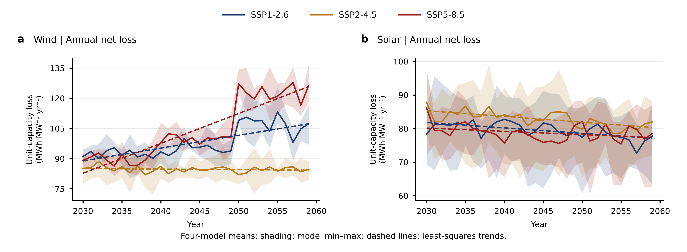
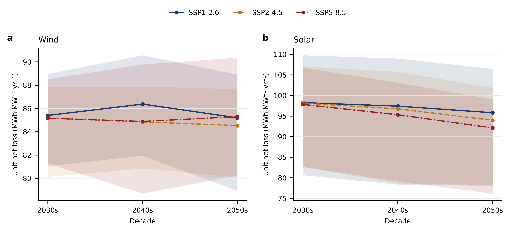
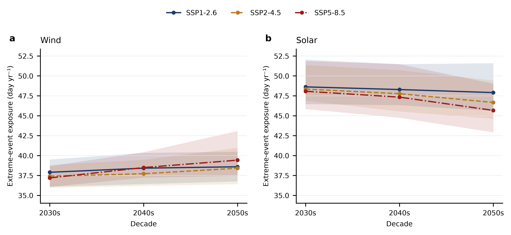
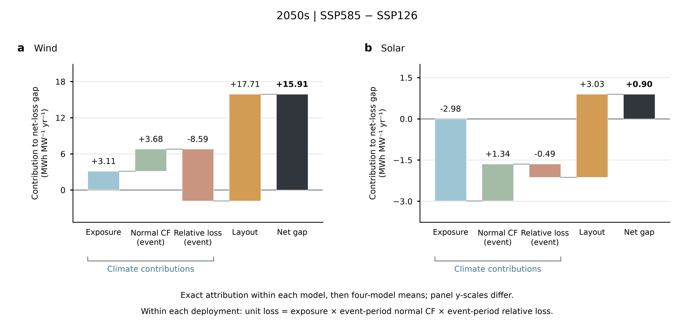
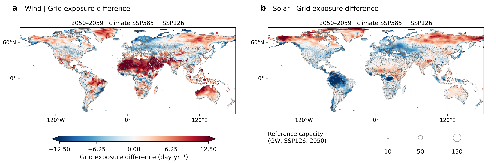
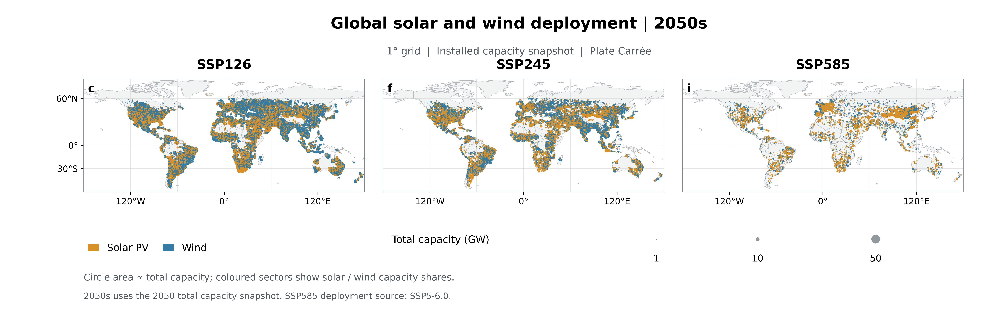

# SSP 故事 v2：转型账单、惩罚归因与选址出路

整理日期：2026-11-02。数据来源：乌镇1866 仓库五类已验收结果——极端事件暴露（全球网格 / 全球适宜格点 / 全球场站）与损失（全球适宜格点 / 全球场站），本地分析快照在 `tmp/ssp_story/`。叙事结构对照 `ref_code/analysis_of_global_south_north/figure_story_20260910`（R1 进程悖论 → R2 惩罚机制 → R3 未来与出路）。

**单位约定**：单位装机净损失 MWh MW⁻¹ yr⁻¹；总账单 TWh/PWh yr⁻¹；暴露为事件并集累计时长 day yr⁻¹（1 day = 24 h，非日历天数）。曲线为四模式（BCC-CSM2-MR、CANESM5、MPI-ESM1-2-HR、MRI-ESM2-0）等权均值，阴影为模式 min–max，非置信区间。

**口径**：场站"路径" = 气候情景 × 部署情景组合（ssp585 气候配 SSP5-6.0 部署表）；固定适宜格点（每格 1 MW）用来剥离纯气候信号。

---

## 背景

三条路径都要求大规模风光扩张（2050s 风光装机 14.1–87.6 TW）。气候变暖过程中频发的极端事件对发电资产造成损失；问题是：路径选择如何决定谁承担气候风险账单，账单的恶化是气候的必然，还是部署的选择？

## RQ1 — 转型账单：扩张最快的路径，没有换来单位风险的改善

**Question**：扩张最快的路径，是否换来了单位风险的改善？

**Result**：没有。绿色路径承担了最大的绝对账单和不断恶化的单位惩罚；扩张越快，损失越超线性。

| 2050s 年总账单 / 装机 | ssp126 | ssp245 | ssp585 |
|---|---:|---:|---:|
| 风光合计损失（PWh yr⁻¹） | **8.29** | 3.52 | 1.32 |
| 风光合计装机（TW） | **87.6** | 42.6 | 14.1 |

- **绝对账单**：SSP1-2.6 的年损失（8.29 PWh）与装机（87.6 TW）均超过 ssp245 与 ssp585 之和（4.84 PWh / 56.6 TW）的 1.7 倍。
- **超线性扩张**：2050s/2030s 的损失增速 > 装机增速，且扩张越快越明显——风电 126 为 3.8× vs 3.3×，585 为 5.1× vs 3.8×；光伏各路径接近线性（126：2.1× vs 2.2×）。
- **单位惩罚不缩反涨**：场站单位装机损失（MWh MW⁻¹ yr⁻¹）风电 126 从 92.3 升至 107.2（+16%）、585 从 89.7 升至 123.1（+37%）；光伏三路径均降但 585 降幅最小（−2.2%）。
- **损失占发电份额几乎冻结**：风电三路径均钉在 7.6–8.1%，光伏 3.6–4.1%——建得再多，损失比例不降，扩张本身在制造一个单位惩罚不断恶化的资产池。

悖论成立：投入（装机）最多、建设最快的路径，单位资产的天气惩罚反而最重。由此逼出归因问题——是气候更凶险，还是部署更冒险？

## RQ2 — 惩罚归因：气候无罪，布局主导

**Question**：单位惩罚的路径分化，是气候更凶险，还是部署更冒险？

**Result**：气候无罪，布局主导。气候只决定"哪种技术受罚"，部署决定"罚多重"。

**纯气候信号**（固定适宜格点，装机固定 1 MW，无部署混杂）：

| 单位装机损失（MWh MW⁻¹ yr⁻¹） | ssp126 | ssp245 | ssp585 |
|---|---:|---:|---:|
| 光伏 2030s → 2050s | 98.2 → 95.8（−2.5%） | 98.1 → 94.0（−4.2%） | 97.8 → 92.1（−5.8%） |
| 风电 2030s → 2050s | 85.4 → 85.2（−0.2%） | 85.2 → 84.5（−0.8%） | 85.2 → 85.3（+0.2%） |

- **风电**：三条 SSP 曲线几乎重合（2050s 最大差 0.8）——RQ1 里风电 +16%/+37% 的单位惩罚恶化，纯气候信号完全给不出。
- **光伏**：损失随变暖**下降**，2050s 排序 126 > 245 > 585（245 > 585 为 4/4 模式，126 > 585 为 3/4）；驱动是真实事件暴露收缩（585 下高湿 −1.0 day yr⁻¹、结冰 −0.8、冻雨 −0.7），非基线口径产物。

**气候与布局的责任分离**（场站 ΔR = ΔR_气候（固定格点项）+ ΔR_布局（残差），2030s → 2050s）：

| | Δ总变化 | Δ气候 | Δ布局 | 布局占比 |
|---|---:|---:|---:|---:|
| 风电 ssp126 | +14.9 | −0.2 | +15.1 | **101%** |
| 风电 ssp585 | +33.4 | +0.1 | +33.3 | **100%** |
| 光伏 ssp585 | −1.8 | −5.7 | +4.0 | 抵消气候红利的 **70%** |

- **风电损失增量的 ≈100% 来自部署布局**：585−126 差（2050s +15.9）的瀑布分解中 layout 项 +17.7（4/4 模式，范围 14.6–23.0），气候三因子合计 ≈ 0 甚至 3/4 模式为负。
- **布局项的载体是强度而非时长**：场站单位暴露日损失 I 从 2.46 升至 3.34 MWh MW⁻¹ day⁻¹（+36%，4/4 模式），暴露天数持平（36.5 → 37.0 day yr⁻¹）——新增机组落在资源更薄的区域，事件来了掉得更深。
- **光伏反向同构**：气候给了 −5.7 的变暖缓解红利，部署地理又拿回 +4.0——RQ1 里 585 光伏降幅最小的原因不在天气。

## RQ3 — 未来与出路：扩张惩罚是选址选择的产物，不是气候命运

**Question**：扩张惩罚是气候命运的必然吗？

**Result**：不是。气候风险增量集中在热带，绿色路径的部署主动拥抱风险区，化石路径恰好避开；既然惩罚来自选址而非气候，选址优化是跨路径通用杠杆。

**气候把新增风险放在了热带**（SSP5-8.5 − SSP1-2.6，2050s 格点暴露差）：

- 风电暴露增量高度集中在热带：热带带均值 +4.5 day yr⁻¹、65% 格点 higher_585；北温带基本持平（−0.1）。高温事件是主要来源（适宜格点上 585 高温暴露 2050s−2030s +3.2 day yr⁻¹，而结冰 −0.8、低资源 −0.4）。
- 光伏反之：热带 −1.6、南温带 −2.1 day yr⁻¹。

**部署对风险区的态度截然相反**：

| 2050s 风电装机（TW） | 热带 | 北温带 | 特征 |
|---|---:|---:|---|
| ssp126 | 5.4（2030 年 1.8，×3） | 6.6 | 全球全面铺开，主动进入热带风险增量区 |
| ssp585（SSP5-6.0） | 0.4 | 0.8 | 集中中国北方/北欧，恰好避开热带增量区 |

于是 RQ1 的悖论得到闭合解释：最绿路径风电单位惩罚也涨 16%，不是气候惩罚没被减缓（RQ2 已证气候无罪），而是大规模扩张本身把机组送进了风险更高的地方。对偶含义：既然损失差异来自选址而非气候，**选址优化在所有路径下都是通用杠杆**。

---

## 逻辑链

RQ1 立"建得最多、单位越差"的账单悖论（现象）→ RQ2 用固定格点 + 布局分解把责任从气候转移给选址（机制）→ RQ3 用热带风险增量 vs 部署落点的错位证明惩罚是选择而非命运，并给出选址杠杆（出路）。

## 口径说明（审稿人必问）

- 站级"路径" = 气候情景 × 部署情景组合：ssp585 气候配 SSP5-6.0 部署表，ssp126/245 同名部署表；固定适宜格点项正是用来从这个组合里剥出纯气候信号的。
- 适宜格点为固定 1 MW 等权（风 574,922 / 光 546,978 个共同有效格点），等价于格点等权，非面积加权；面积加权对照不改变方向结论。
- 低资源事件按各模式/SSP 自身 2015–2024 基线定义；RQ2 光伏暴露收缩主要由高湿/结冰/冻雨等真实阈值事件贡献，非基线口径产物。
- 阴影为四模式 min–max，非置信区间。
- RQ1 的 8.3 PWh 为 2050s 十年窗口的年均值；各路径场站集合不同（585 用 SSP5-6.0 部署表），跨路径绝对量比较隐含装机规模差异，单位装机指标已并列给出。

## 支撑数据表（本地 `tmp/ssp_story/`，远端 1866 仓库）

| RQ | 数据类别 | 表 |
|---|---|---|
| 1 | 全球场站损失 | `fig02/capacity_coverage.csv`（账单/装机/增速）、`fig02/global_window_models.csv`（单位损失、annual_loss_pct） |
| 2 | 全球适宜格点损失 + 全球场站损失 | `suitable_grid_loss/decadal_ensemble.csv`、`suitable_grid_extreme/single_events_decadal.csv`、`fig02/fig02_climate_layout_waterfall_2050s_{display,models}.csv`、`fig02/union_factors_models.csv`（E_days / I） |
| 3 | 全球网格暴露 + 全球场站 | `fig01/panel_ab_days.csv.gz`（585−126 格点差）、`fig01/station_deployment_1deg.csv.gz`（部署落点） |

远端原始图件路径：`paper_figures/supplementary/suitable_grid_{loss,extreme}/outputs/`、`paper_figures/main/fig02_generation_loss/outputs/`、`paper_figures/main/fig01_extreme_events/outputs/`。
