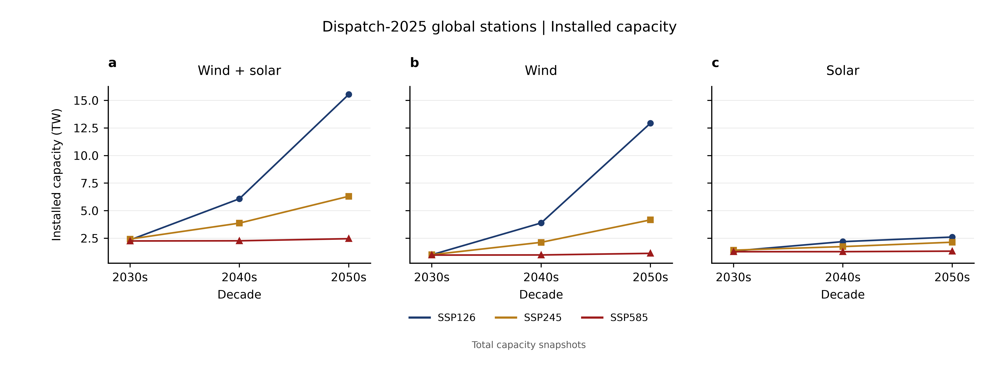
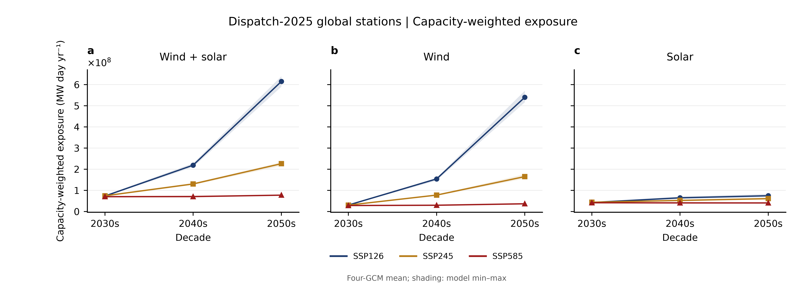
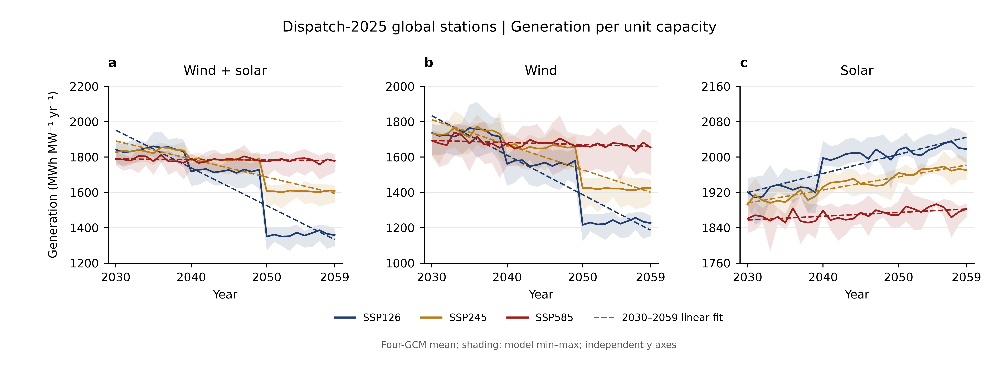

# 全球场站-dispatch-2025 气候评价

已完成：4个GCM × 3气候SSP × 3场站SSP × 2技术，2030—2059的CF、Extreme、逐事件Loss和全年发电量均已发布。统一索引包含36,720份CF/Extreme分片、3,060份年度逐事件NetCDF和72份完整目录年度NPZ；8张三面板图及24张独立子图展示SSP126、SSP245、SSP585三条配对路径，全部通过数值、导出和视觉检查。

## 范围与输入

方案名称为 **全球场站-dispatch-2025**。场站来自选址项目的 `results/campaign_runs/capacity_recovery_20261113T222351/MPI-ESM1-2-HR`，使用 SSP126、SSP245、SSP585 下的九份 `stations_01deg_2030/2040/2050.csv`。原始文件及各路径的验收 manifest 保留于新增共享根的 `inputs/stations/`。准备阶段核对九份0.1° CSV及九份1°父格校验表的SHA256，按上游记录的逐父格误差限检查聚合容量；计算保留0.1° CSV原值。

布局采用 GEM2025 存量初始化，在 MPI-ESM1-2-HR 未来单年 CF 下优化。气候评价保留四个 GCM：CANESM5、MPI-ESM1-2-HR、MRI-ESM2-0、BCC-CSM2-MR；每个 GCM 均包含三气候 SSP × 三场站 SSP 的完整交叉组合。两技术为风电与光伏；时间仅为2030—2059。2030、2040、2050装机快照分别用于对应完整十年，容量为总量。

SSP585选址来自作业 `49177195`，正式验收来自作业 `49197708`；manifest的 `case.code_commit=a4d5a253c78b50f875d896abb4d5d26ea5a55e1b` 记录验收版本。三个年代的弃电率上限分别为0.5、0.522、0.5；验收确认场站容量未改变。上游完整验收及其文件哈希保留于 `inputs/upstream_acceptance.json`。

光伏容量为 MWp/DC，风电为 MW；风电发电量与损失不缩放。场站 ID 包含方案、场站SSP、技术及0.1°网格ID。不同场站SSP不能直接按行号或站点ID合并。

## 共享位置与权限

统一读取根：

`/work/home/acxujo26gv/dispatch_2025_climate_storage/ssp585/`

```text
ssp585/
├── inputs/                         # 九份布局、父格校验表、来源与代码清单
├── future/                         # 新增五组合的原生CF / Extreme、目录及映射
├── loss_future/                    # 新增五组合的逐事件年度损失和基线
├── station_results/future/         # 新增40份完整目录年度档案
├── source_data/                    # 完整九组合的全球逐模式与集合汇总CSV
├── report/                         # 更新后的独立报告、图件、源表和脚本副本
├── runtime/authoritative_index.json
└── runtime/completion.json
```

统一索引同时引用原四组合和新增五组合。原结果继续保存在 `/work/home/acxujo26gv/dispatch_2025_climate_storage/`；新增根物理保存20,400份CF/Extreme分片、1,700份年度Loss NetCDF和40份年度NPZ。应从新索引按绝对路径读取完整矩阵。

共享报告入口为新增根的 `report/document/全球场站-dispatch-2025气候评价.md`，包含全部图件、绘图源表、验收记录和对应脚本副本；本轮科学计算使用新增根 `code/` 下的冻结代码。

1959保存结果。1892执行气候SSP126，1520执行SSP245，1870执行SSP585，均写入新增共享根。1866及其他账号可读不可写；已用1866和1775读取正式索引、四份汇总CSV及原发布、新发布两技术的CF、Extreme、Loss、年度NPZ代表文件，并确认没有写权限。新建目录默认给其他用户遍历和读取权限，文件默认可读。

正式使用时，先检查 `runtime/completion.json` 和 `runtime/authoritative_index.json` 均为 `COMPLETED`，并核对索引SHA256。计算过程中出现的分片不等于整套数据已经发布。

## 数据口径

- CF / Extreme 从原数据指南声明的全球网格正式索引提取，保留原生三小时时间、模式日历、CF原值和0/1/缺测事件编码。按场站所在0.1°栅格映射至已发布BCSD采样点；目录保留未映射站点及容量。文件名沿用源分片名，实际时间范围以索引 `years` 和NetCDF时间轴为准。
- 原生时间轴核对（覆盖各组合最大分块）：CANESM5、BCC-CSM2-MR采用`365_day`日历，2030—2059共87,600个三小时时刻；MPI-ESM1-2-HR、MRI-ESM2-0采用`proleptic_gregorian`，共87,656个时刻。风电时间戳每天从00:00起，光伏从01:30起。CF和Extreme分片年份边界不同，读取时分别拼接后按原生时间轴对齐。
- CF / Extreme 未施加投运掩膜；三个快照容量作为元数据保存。年度能量按相应年代的实际容量计算，使用时显式筛选正容量。
- Extreme包含风电5类、光伏6类事件，保留原低资源事件的2015—2024资源异常基准。ERA5-Land位于 `/work/home/acbw9wpn5k/bcsd/data/ERA5_land/global/`；本轮不计算历史期。
- Loss正常CF在2030—2039、2040—2049、2050—2059分别排除事件并集后，按月—小时有效CF求和除以样本数，保存12×8槽位的正常CF与样本数。它与低资源事件基准含义不同。
- 各事件及 `all` 的年度损失复用原 `generation_loss.metrics` 公式。`all` 是时间并集；正损失和带符号净损失分别保留。净损失等于同一有效事件时段的正常电量减实际电量。
- 全年发电量由全年CF积分；采用模式原生日历小时数。全年CF覆盖不完整时，全年发电量保持缺测。
- 原核的 `normal_all_generation_mwh_*` 在CF、正常CF和对应事件标记均有效的时刻积分；`loss_valid_count`记录 `all` 并集口径下的有效样本数。净损失比例使用这一有效时间内的正常基准电量。
- 暴露图采用Extreme并集的 `event_hours`，由已知事件标记计时；损失指标中的 `loss_event_hours`／`event_duration_hours_all` 还要求CF和正常CF有效。两类有效样本数分别保存在 `signal_valid_count` 和 `loss_valid_count`。
- 全球汇总使用同一有效集合计算分子、分母。汇总档案采用每个气候SSP×场站SSP×技术内部跨四模式、跨30年的共同有效站点：完整CF、至少99%有效事件时刻、有限净损失及正的全年正常基准。原生年度NetCDF保留映射站点的逐年原始指标及缺测；共同支持筛选只用于汇总档案与图件。
- 单位装机净损失为总净损失除以有效容量；净损失比例为总净损失除以上述有效时间内的全年正常基准电量。先逐模式计算比值，再等权汇总四模式。
- 目录容量、映射容量、最终有效容量及覆盖率分别保存。不能把未映射或无效场站当作零损失，也不能用完整目录容量替换有效分母。

## 读取入口

统一索引的 `entries[]` 提供CF、Extreme，包含 `model`、`climate_scenario`、`station_scenario`、`tech`、`patch`、`status` 和 `artifacts[]`。仅按已完成条目读取；空分块显式标记 `EMPTY_NO_STATIONS`。

`loss_files[]` 提供逐分块年度NetCDF，维度为 `year, station`，另有 `window, month_hour_idx, station` 正常CF基线。变量沿用原Loss的事件后缀，包括：

| 变量 | 含义与单位 |
|---|---|
| `net_generation_loss_mwh_<event>` | 带符号净损失，MWh |
| `generation_loss_mwh_<event>` | 正损失，MWh |
| `net_generation_loss_per_mw_<event>` | 单位装机净损失，MWh/MW |
| `normal_generation_mwh_<event>` / `actual_generation_mwh_<event>` | 事件期正常／实际发电量，MWh |
| `normal_all_generation_mwh_<event>` | 对应有效全年正常基准电量，MWh |
| `event_duration_hours_<event>` / `loss_hours_<event>` | 事件／损失时长，小时 |
| `all_generation_mwh` / `annual_cf` | 全年实际CF积分发电量／年均CF |
| `cf_normal` / `baseline_count` | 三个十年窗口的正常CF／有效样本数 |

波动、相对损失、强度和归一化等原生指标同时保留。各事件可能重叠，不能相加替代 `all`。

`annual_archives[]` 提供72份完整站点年度NPZ，按模式、双SSP和技术定位，保存 `grid_id`、容量、全年发电、净损失、CF、事件小时数及 `common_support`。72份档案的模式、双SSP、技术、站点目录和容量快照均已通过最终校验。

`summaries` 提供全球汇总CSV及SHA256。`global_annual_models.csv` 为3,240行（含风光合并），`global_annual_ensemble.csv` 为810行；完整情景、年份、技术和模式矩阵已通过校验。`capacity_coverage.csv` 保存完整、映射及有效容量，`catalogue_capacity.csv` 保存三个年代的目录容量。

## 汇总覆盖

下表为30年及四模式范围内的有效装机覆盖率。共同有效集合在每个双SSP×技术组内固定；每年正容量站点数仍会随十年快照改变。

| 气候SSP | 场站SSP | 技术 | 有效容量覆盖率 | 年度正容量有效站点数 |
|---|---|---|---:|---:|
| SSP126 | SSP126 | 光伏 | 98.04–98.99% | 30,743–109,043 |
| SSP126 | SSP126 | 风电 | 97.26–99.76% | 10,390–100,200 |
| SSP126 | SSP245 | 光伏 | 98.15–98.77% | 32,516–99,981 |
| SSP126 | SSP245 | 风电 | 97.27–99.32% | 10,536–68,975 |
| SSP126 | SSP585 | 光伏 | 97.95–98.03% | 29,110–78,041 |
| SSP126 | SSP585 | 风电 | 97.18–97.56% | 10,008–54,844 |
| SSP245 | SSP126 | 光伏 | 98.04–98.99% | 30,743–109,043 |
| SSP245 | SSP126 | 风电 | 97.26–99.76% | 10,390–100,200 |
| SSP245 | SSP245 | 光伏 | 98.15–98.77% | 32,516–99,981 |
| SSP245 | SSP245 | 风电 | 97.27–99.32% | 10,536–68,971 |
| SSP245 | SSP585 | 光伏 | 97.95–98.03% | 29,110–78,041 |
| SSP245 | SSP585 | 风电 | 97.18–97.56% | 10,008–54,842 |
| SSP585 | SSP126 | 光伏 | 98.04–98.99% | 30,743–109,043 |
| SSP585 | SSP126 | 风电 | 97.26–99.76% | 10,390–100,198 |
| SSP585 | SSP245 | 光伏 | 98.15–98.77% | 32,516–99,981 |
| SSP585 | SSP245 | 风电 | 97.27–99.33% | 10,536–68,975 |
| SSP585 | SSP585 | 光伏 | 97.95–98.03% | 29,110–78,041 |
| SSP585 | SSP585 | 风电 | 97.18–97.56% | 10,008–54,841 |

完整目录保留未映射及未进入共同有效集合的容量；原生输出保留已映射站点的逐年指标和缺测。全球比值和图件使用上述共同有效集合。

## 图件约定

绘图在1866项目执行，目录为 [dispatch_2025](../paper_figures/supplementary/dispatch_2025/)。已输出8张完整三面板PNG及24张独立子图，600 dpi；三列依次为风光合并、风电、光伏。

装机和暴露展示2030s、2040s、2050s三个点，暴露先对每模式取十年均值。损失和发电展示2030—2059逐年四模式均值，并叠加全30年OLS描述趋势。阴影为四模式最小—最大值，不表示置信区间。配对路径126/126、245/245、585/585的差异同时包含气候与部署变化。

### 装机容量

基于已验收的完整场站目录，2030、2040、2050分别代表对应十年的总装机快照。面板a为风光合计，b为风电，c为光伏。容量不随气候评价模式变化。



独立子图：[a：风光合计](../paper_figures/supplementary/dispatch_2025/outputs/dispatch2025_capacity_a.png)、[b：风电](../paper_figures/supplementary/dispatch_2025/outputs/dispatch2025_capacity_b.png)、[c：光伏](../paper_figures/supplementary/dispatch_2025/outputs/dispatch2025_capacity_c.png)。[数值源表](../paper_figures/supplementary/dispatch_2025/outputs/source_data/capacity_display.csv)。

| 场站情景 | 快照 | 风电（TW） | 光伏（TWp/DC） | 风光合计（TW） |
|---|---:|---:|---:|---:|
| SSP126 | 2030 | 1.005 | 1.342 | 2.348 |
| SSP126 | 2040 | 3.886 | 2.193 | 6.080 |
| SSP126 | 2050 | 12.933 | 2.608 | 15.542 |
| SSP245 | 2030 | 1.008 | 1.418 | 2.427 |
| SSP245 | 2040 | 2.129 | 1.742 | 3.872 |
| SSP245 | 2050 | 4.165 | 2.140 | 6.305 |
| SSP585 | 2030 | 0.974 | 1.280 | 2.255 |
| SSP585 | 2040 | 0.985 | 1.284 | 2.269 |
| SSP585 | 2050 | 1.130 | 1.330 | 2.460 |

### 装机加权暴露总量

Extreme事件并集的年度小时数先换算为天，再按有效容量加权求和；每模式取十年平均。单位为MW day yr⁻¹。



独立子图：[a：风光合计](../paper_figures/supplementary/dispatch_2025/outputs/dispatch2025_exposure_total_a.png)、[b：风电](../paper_figures/supplementary/dispatch_2025/outputs/dispatch2025_exposure_total_b.png)、[c：光伏](../paper_figures/supplementary/dispatch_2025/outputs/dispatch2025_exposure_total_c.png)。[数值源表](../paper_figures/supplementary/dispatch_2025/outputs/source_data/exposure_total_display.csv)。

### 装机加权年均暴露时长

暴露总量除以同一有效集合的装机容量，得到每年平均暴露天数；每模式取十年平均。


独立子图：[a：风光合计](../paper_figures/supplementary/dispatch_2025/outputs/dispatch2025_exposure_mean_a.png)、[b：风电](../paper_figures/supplementary/dispatch_2025/outputs/dispatch2025_exposure_mean_b.png)、[c：光伏](../paper_figures/supplementary/dispatch_2025/outputs/dispatch2025_exposure_mean_c.png)。[数值源表](../paper_figures/supplementary/dispatch_2025/outputs/source_data/exposure_mean_display.csv)。

### 总净损失

展示事件并集的带符号净损失，单位为MWh yr⁻¹。实际发电高于正常基准的事件时段可贡献负净损失。


独立子图：[a：风光合计](../paper_figures/supplementary/dispatch_2025/outputs/dispatch2025_total_loss_a.png)、[b：风电](../paper_figures/supplementary/dispatch_2025/outputs/dispatch2025_total_loss_b.png)、[c：光伏](../paper_figures/supplementary/dispatch_2025/outputs/dispatch2025_total_loss_c.png)。[数值源表](../paper_figures/supplementary/dispatch_2025/outputs/source_data/total_loss_display.csv)。

### 单位装机净损失

逐模式总净损失除以同一有效容量，单位为MWh MW⁻¹ yr⁻¹。三个面板使用独立纵轴、各六个等距刻度。


独立子图：[a：风光合计](../paper_figures/supplementary/dispatch_2025/outputs/dispatch2025_unit_loss_a.png)、[b：风电](../paper_figures/supplementary/dispatch_2025/outputs/dispatch2025_unit_loss_b.png)、[c：光伏](../paper_figures/supplementary/dispatch_2025/outputs/dispatch2025_unit_loss_c.png)。[数值源表](../paper_figures/supplementary/dispatch_2025/outputs/source_data/unit_loss_display.csv)。

### 净损失占全年正常基准电量比例

逐模式净损失除以相同有效时段的全年正常基准电量，单位为%。三个面板使用独立纵轴。


独立子图：[a：风光合计](../paper_figures/supplementary/dispatch_2025/outputs/dispatch2025_loss_fraction_a.png)、[b：风电](../paper_figures/supplementary/dispatch_2025/outputs/dispatch2025_loss_fraction_b.png)、[c：光伏](../paper_figures/supplementary/dispatch_2025/outputs/dispatch2025_loss_fraction_c.png)。[数值源表](../paper_figures/supplementary/dispatch_2025/outputs/source_data/loss_fraction_display.csv)。

### 全年总发电量

全年CF按模式日历积分并乘以对应年代容量，单位为PWh yr⁻¹；容量在2040和2050切换为新总量快照。


独立子图：[a：风光合计](../paper_figures/supplementary/dispatch_2025/outputs/dispatch2025_total_generation_a.png)、[b：风电](../paper_figures/supplementary/dispatch_2025/outputs/dispatch2025_total_generation_b.png)、[c：光伏](../paper_figures/supplementary/dispatch_2025/outputs/dispatch2025_total_generation_c.png)。[数值源表](../paper_figures/supplementary/dispatch_2025/outputs/source_data/total_generation_display.csv)。

### 单位装机全年发电量

逐模式全年总发电除以同一有效容量，单位为MWh MW⁻¹ yr⁻¹。三个面板使用独立纵轴。



独立子图：[a：风光合计](../paper_figures/supplementary/dispatch_2025/outputs/dispatch2025_unit_generation_a.png)、[b：风电](../paper_figures/supplementary/dispatch_2025/outputs/dispatch2025_unit_generation_b.png)、[c：光伏](../paper_figures/supplementary/dispatch_2025/outputs/dispatch2025_unit_generation_c.png)。[数值源表](../paper_figures/supplementary/dispatch_2025/outputs/source_data/unit_generation_display.csv)。


## 复现与验收

- [阶段目标和运行合同](../scnet/dispatch_2025/ssp585_goal.md)
- [输入准备](../scnet/dispatch_2025/prepare.py)
- [作业生成器](../scnet/create_dispatch_2025_jobs.py)
- [监控与按账号补交](../scnet/dispatch_2025/watch.py)
- [逐事件Loss](../utils/dispatch_station_climate/loss.py)
- [索引与汇总发布](../utils/dispatch_station_climate/publish.py)
- [绘图代码](../paper_figures/supplementary/dispatch_2025/plot.py)

科学计算使用共享代码快照的 `.venv`。每账号所有项目活动作业上限20，提交前持账号锁并重新计数。登录节点仅作调度、元数据处理和已有小型汇总表绘图。冻结任务、源代码/输入SHA256和逐任务回执保存在共享结果根；本地 `scnet/dispatch_2025/completion_status/` 保存状态镜像。

2026-11-18完成SSP585补全验收。下表增量阶段均相对于新增共享根，正式索引为完整九组合：

| 阶段 | 已完成数量 | 验收记录（相对于新增共享根） |
|---|---:|---|
| CF / Extreme提取 | 新增2,040任务；20,400分片 | `future/runtime/extraction_accepted.json` |
| 逐事件Loss | 新增1,700任务；1,700 NetCDF及1,700中间NPZ | `loss_future/runtime/loss_accepted.json` |
| 汇总发布 | 新增10组；40年度NPZ | `publish/runtime/publication_groups_accepted.json` |
| 正式索引 | 72年度NPZ；3,240逐模式行；810集合行 | `runtime/completion.json` |
| 共享读取 | 1866及1775实测通过 | `runtime/formal_access.json` |
| 独立报告副本 | 文件哈希与相对链接核对 | `report/manifest.json`、`runtime/report_access.json` |

最终验收作业 `49290002` 为Slurm COMPLETED/0:0，验证原发布来源与档案哈希、全部新增逐事件NetCDF的目录ID、时间、事件字段、维度和单位，以及72份年度NPZ的完整目录、容量快照和支持集合；同时检查全球矩阵、能量闭合及原四组合汇总值与原发布一致。发布时检查了新增根58,963个文件、9,109个目录的读取/遍历权限。完整统一索引引用文件总计1,204,770,510,155字节（不含分块年度中间NPZ、代码和日志）。

绘图验收见 [figure_validation.json](../paper_figures/supplementary/dispatch_2025/outputs/figure_validation.json) 和 [manifest.json](../paper_figures/supplementary/dispatch_2025/outputs/manifest.json)：8张组图、24张独立子图、600 dpi、全部图值与源表一致、45条OLS拟合、组图/独立图纵轴一致；全部PNG已检查文字裁切、图例、范围和阴影。全量图值见 [source_data/](../paper_figures/supplementary/dispatch_2025/outputs/source_data/)，OLS参数见 [trend_fits.csv](../paper_figures/supplementary/dispatch_2025/outputs/source_data/trend_fits.csv)。

准备、提取、Loss和发布均经过首批验证后再运行全矩阵。正式提取使用2核、Loss使用1核；本轮完整Loss最大MaxRSS为1.787 GiB，发布最大为1.793 GiB。任务按气候SSP分配到1892/1520/1870，并遵循每账号全项目20个活动作业上限。

### 最小读取示例

在能读取共享根的远程账号及仓库Python环境中运行：

```python
import hashlib
import json
from pathlib import Path

root = Path("/work/home/acxujo26gv/dispatch_2025_climate_storage/ssp585")
completion = json.loads((root / "runtime/completion.json").read_text())
index_path = root / "runtime/authoritative_index.json"
assert completion["status"] == "COMPLETED"
assert hashlib.sha256(index_path.read_bytes()).hexdigest() == completion["index_sha256"]
index = json.loads(index_path.read_text())
archive = next(a for a in index["annual_archives"]
               if a["model"] == "MPI-ESM1-2-HR"
               and a["climate_ssp"] == "ssp585"
               and a["station_ssp"] == "ssp585"
               and a["tech"] == "wind")
print(archive["path"])
```

读取年度NPZ时，`capacity_mw`包含完整目录容量；使用 `common_support` 与当年正容量筛选有效汇总站点。读取逐事件NetCDF时，通过 `loss_files[]` 定位；读取原生CF/Extreme时，通过 `entries[]` 的双情景、模式、技术和分块定位，依据实际时间坐标拼接。
