# 风电光伏数据

## 数据表格

### 指标总览

| 口径 | 装机量 | 极端事件（暴露时长） | 损失 | 发电 |
| --- | --- | --- | --- | --- |
| 全球网格 | \ | 面积加权暴露时长(天/年) | \ | \ |
| 全球适宜性网格 | \ | 面积加权暴露时长(天/年) | 单位装机损失(MWh/MW/年) | \ |
| 全球场站-dispatch | 总装机容量(TW) | 装机容量加权暴露总量(MW·天/年) 装机容量加权年均暴露时长(天/年) | 总损失(MWh/年) 单位装机损失(MWh/MW/年) 单位发电损失(%) | 总发电(PWh/年) 单位装机发电(MWh/MW/年) |
| 全球场站-LCOE | 总装机容量(TW) | 装机容量加权暴露总量(MW·天/年) 装机容量加权年均暴露时长(天/年) | 总损失(MWh/年) 单位装机损失(MWh/MW/年) 单位发电损失(%) | 总发电(PWh/年) 单位装机发电(MWh/MW/年) |
| 全球场站-LCOE-2025 | 完整目录总装机容量（TW） | 容量加权暴露总量（MW·天/年） 平均暴露时长（天/年） | 总净损失（MWh/年） 单位装机净损失（MWh/MW/年） 正常年电量损失占比（%） | 总发电（PWh/年） 单位装机发电（MWh/MW/年） 容量加权CF |
| 固定2025装机 | 2026—2059固定2025装机 | 容量加权暴露总量（MW·天/年） 平均暴露时长（天/年） | 总净损失（MWh/年） 单位装机净损失（MWh/MW/年） 正常年电量损失占比（%） | 总发电（PWh/年） 单位装机发电（MWh/MW/年） 容量加权CF |

### 原有结果与输入

| 编号 | 已有结果路径 | 使用内容 |
| --- | --- | --- |
| A | `paper_figures/prepare/outputs/catalogues/capacity_by_country.csv` | 按国家汇总的各技术、SSP、快照目录容量；全球求和 |
| B | `paper_figures/main/fig01_extreme_events/outputs/source_data/panel_cd_grid.csv` | 风电、光伏全球网格面积加权事件并集暴露，含分子和面积 |
| C | `paper_figures/supplementary/suitable_grid_extreme/outputs/source_data/annual_primary.csv` | 适宜性网格面积加权暴露的年度分子、分母；仅使用 all |
| D | `paper_figures/main/fig01_extreme_events/outputs/source_data/panel_cd_coverage.csv` | 场站年代年均容量—暴露小时总量、有效容量与目录容量 |
| E | `paper_figures/prepare/outputs/suitable_grid_loss/annual.csv.gz` | 每格1 MW的年度净损失之和、有效技术网格数；common 样本 |
| F | `paper_figures/main/fig02_generation_loss/outputs/source_data/panel_ab.csv` | 场站逐模式逐年净损失、有效容量、全年正常基准发电量 |
| F（合并） | `paper_figures/main/fig02_generation_loss/outputs/source_data/combined_loss_models.csv` | 已有风光合并年度损失；用于复现校验 |
| G | `paper_figures/main/fig02_generation_loss/outputs/source_data/combined_generation_technology_annual.csv` | 分技术的完整年度CF、容量、原生日历小时数与发电量 |
| G（合并） | `paper_figures/main/fig02_generation_loss/outputs/source_data/combined_generation_annual_models.csv` | 已有风光合并年度发电量；用于复现校验 |
| U | `paper_figures/main/fig01_extreme_events/outputs/grid_union/<model>/<ssp>/<patch>.nc` | 已有逐格点跨技术事件时间并集年度缓存，附同名 JSON 核查记录 |
| U（单技术缓存） | `RQ1_extreme/global/grid/outputs/<model>/cache/<ssp>/<tech>/<patch>.nc` | 仅适宜一种技术的格点使用对应技术的 any 事件 |
| U（适宜掩膜） | `paper_figures/supplementary/suitable_grid_extreme/outputs/source_data/patches/<tech>/<patch>/mapping.csv.gz` | 适宜技术、地理坐标及共同有效掩膜 |

### 11个指标的结果路径

| 类别 | 口径 | 指标 | 输入编号 | 本次处理 | 完整趋势图 | 逐模式计算结果 | 绘图均值 |
| --- | --- | --- | --- | --- | --- | --- | --- |
| 装机量 | 全球场站-dispatch | 总装机容量（TW） | A | 已有容量汇总；本次整理风光合并 | [PNG](../paper_figures/supplementary/global_metric_trends/outputs/station_capacity.png) | [CSV](../paper_figures/supplementary/global_metric_trends/outputs/source_data/station_capacity_models.csv) | [CSV](../paper_figures/supplementary/global_metric_trends/outputs/source_data/station_capacity_display.csv) |
| 极端事件（暴露时长） | 全球网格 | 面积加权年均暴露时长（天/年） | B；U | 分技术已有；本次汇总跨技术时间并集 | [PNG](../paper_figures/supplementary/global_metric_trends/outputs/grid_exposure.png) | [CSV](../paper_figures/supplementary/global_metric_trends/outputs/source_data/grid_exposure_models.csv) | [CSV](../paper_figures/supplementary/global_metric_trends/outputs/source_data/grid_exposure_display.csv) |
| 极端事件（暴露时长） | 全球适宜性网格 | 面积加权年均暴露时长（天/年） | C；U | 分技术已有；本次补算适宜范围内跨技术时间并集 | [PNG](../paper_figures/supplementary/global_metric_trends/outputs/suitable_grid_exposure.png) | [CSV](../paper_figures/supplementary/global_metric_trends/outputs/source_data/suitable_grid_exposure_models.csv) | [CSV](../paper_figures/supplementary/global_metric_trends/outputs/source_data/suitable_grid_exposure_display.csv) |
| 极端事件（暴露时长） | 全球场站-dispatch | 装机容量加权暴露总量（MW·天/年） | D | 分技术已有；本次补算风光合并 | [PNG](../paper_figures/supplementary/global_metric_trends/outputs/station_exposure_total.png) | [CSV](../paper_figures/supplementary/global_metric_trends/outputs/source_data/station_exposure_total_models.csv) | [CSV](../paper_figures/supplementary/global_metric_trends/outputs/source_data/station_exposure_total_display.csv) |
| 极端事件（暴露时长） | 全球场站-dispatch | 装机容量加权年均暴露时长（天/年） | D | 分技术已有；本次补算风光合并 | [PNG](../paper_figures/supplementary/global_metric_trends/outputs/station_exposure_mean.png) | [CSV](../paper_figures/supplementary/global_metric_trends/outputs/source_data/station_exposure_mean_models.csv) | [CSV](../paper_figures/supplementary/global_metric_trends/outputs/source_data/station_exposure_mean_display.csv) |
| 损失 | 全球适宜性网格 | 单位装机净损失（MWh/MW/年） | E | 分技术已有；本次补算风光合并 | [PNG](../paper_figures/supplementary/global_metric_trends/outputs/suitable_grid_unit_loss.png) | [CSV](../paper_figures/supplementary/global_metric_trends/outputs/source_data/suitable_grid_unit_loss_models.csv) | [CSV](../paper_figures/supplementary/global_metric_trends/outputs/source_data/suitable_grid_unit_loss_display.csv) |
| 损失 | 全球场站-dispatch | 总净损失（MWh/年） | F | 分技术和风光合并已有；本次统一汇总 | [PNG](../paper_figures/supplementary/global_metric_trends/outputs/station_total_loss.png) | [CSV](../paper_figures/supplementary/global_metric_trends/outputs/source_data/station_total_loss_models.csv) | [CSV](../paper_figures/supplementary/global_metric_trends/outputs/source_data/station_total_loss_display.csv) |
| 损失 | 全球场站-dispatch | 单位装机净损失（MWh/MW/年） | F | 分技术和风光合并已有；本次统一汇总 | [PNG](../paper_figures/supplementary/global_metric_trends/outputs/station_unit_loss.png) | [CSV](../paper_figures/supplementary/global_metric_trends/outputs/source_data/station_unit_loss_models.csv) | [CSV](../paper_figures/supplementary/global_metric_trends/outputs/source_data/station_unit_loss_display.csv) |
| 损失 | 全球场站-dispatch | 年净损失占全年正常基准电量比例（%） | F | 分技术已有；本次补算风光合并 | [PNG](../paper_figures/supplementary/global_metric_trends/outputs/station_loss_fraction.png) | [CSV](../paper_figures/supplementary/global_metric_trends/outputs/source_data/station_loss_fraction_models.csv) | [CSV](../paper_figures/supplementary/global_metric_trends/outputs/source_data/station_loss_fraction_display.csv) |
| 发电 | 全球场站-dispatch | 总发电量（PWh/年） | G | 分技术和风光合并已有；本次统一汇总 | [PNG](../paper_figures/supplementary/global_metric_trends/outputs/station_total_generation.png) | [CSV](../paper_figures/supplementary/global_metric_trends/outputs/source_data/station_total_generation_models.csv) | [CSV](../paper_figures/supplementary/global_metric_trends/outputs/source_data/station_total_generation_display.csv) |
| 发电 | 全球场站-dispatch | 单位装机发电量（MWh/MW/年） | G | 合并已有；本次显式输出分技术指标 | [PNG](../paper_figures/supplementary/global_metric_trends/outputs/station_unit_generation.png) | [CSV](../paper_figures/supplementary/global_metric_trends/outputs/source_data/station_unit_generation_models.csv) | [CSV](../paper_figures/supplementary/global_metric_trends/outputs/source_data/station_unit_generation_display.csv) |

### LCOE-2025与固定2025装机结果路径

正式CF、Extreme、Loss与全年发电量入口见[数据指南第13节](BCSD_v2数据使用指南.md#lcoe-2025)。固定装机逐模式表保存2026—2059，历史段见LCOE-2025逐模式表。

| 口径 | 指标 | 完整图 | 逐模式结果 | 绘图均值 |
| --- | --- | --- | --- | --- |
| 全球场站-LCOE-2025 | 总净损失 | [PNG](../paper_figures/supplementary/global_metric_trends/outputs/gem2025_station_total_loss.png) | [CSV](../paper_figures/supplementary/global_metric_trends/outputs/source_data/gem2025_models.csv) | [CSV](../paper_figures/supplementary/global_metric_trends/outputs/source_data/gem2025_display.csv) |
| 全球场站-LCOE-2025 | 单位装机净损失 | [PNG](../paper_figures/supplementary/global_metric_trends/outputs/gem2025_station_unit_loss.png) | [CSV](../paper_figures/supplementary/global_metric_trends/outputs/source_data/gem2025_models.csv) | [CSV](../paper_figures/supplementary/global_metric_trends/outputs/source_data/gem2025_display.csv) |
| 全球场站-LCOE-2025 | 净损失占正常基准电量比例 | [PNG](../paper_figures/supplementary/global_metric_trends/outputs/gem2025_station_loss_fraction.png) | [CSV](../paper_figures/supplementary/global_metric_trends/outputs/source_data/gem2025_models.csv) | [CSV](../paper_figures/supplementary/global_metric_trends/outputs/source_data/gem2025_display.csv) |
| 全球场站-LCOE-2025 | 全年总发电量 | [PNG](../paper_figures/supplementary/global_metric_trends/outputs/gem2025_station_total_generation.png) | [CSV](../paper_figures/supplementary/global_metric_trends/outputs/source_data/gem2025_models.csv) | [CSV](../paper_figures/supplementary/global_metric_trends/outputs/source_data/gem2025_display.csv) |
| 全球场站-LCOE-2025 | 单位装机全年发电量 | [PNG](../paper_figures/supplementary/global_metric_trends/outputs/gem2025_station_unit_generation.png) | [CSV](../paper_figures/supplementary/global_metric_trends/outputs/source_data/gem2025_models.csv) | [CSV](../paper_figures/supplementary/global_metric_trends/outputs/source_data/gem2025_display.csv) |
| 全球场站-LCOE-2025 | 完整目录装机容量 | [PNG](../paper_figures/supplementary/global_metric_trends/outputs/gem2025_station_capacity.png) | [CSV](../paper_figures/supplementary/global_metric_trends/outputs/source_data/gem2025_models.csv) | [CSV](../paper_figures/supplementary/global_metric_trends/outputs/source_data/gem2025_display.csv) |
| 全球场站-LCOE-2025 | 装机加权暴露总量 | [PNG](../paper_figures/supplementary/global_metric_trends/outputs/gem2025_station_exposure_total.png) | [CSV](../paper_figures/supplementary/global_metric_trends/outputs/source_data/gem2025_models.csv) | [CSV](../paper_figures/supplementary/global_metric_trends/outputs/source_data/gem2025_display.csv) |
| 全球场站-LCOE-2025 | 装机加权平均暴露时长 | [PNG](../paper_figures/supplementary/global_metric_trends/outputs/gem2025_station_exposure_mean.png) | [CSV](../paper_figures/supplementary/global_metric_trends/outputs/source_data/gem2025_models.csv) | [CSV](../paper_figures/supplementary/global_metric_trends/outputs/source_data/gem2025_display.csv) |
| 全球场站-LCOE-2025 | 容量加权全年平均CF | [PNG](../paper_figures/supplementary/global_metric_trends/outputs/gem2025_station_cf.png) | [CSV](../paper_figures/supplementary/global_metric_trends/outputs/source_data/gem2025_models.csv) | [CSV](../paper_figures/supplementary/global_metric_trends/outputs/source_data/gem2025_display.csv) |
| 固定2025装机 | 总净损失 | [PNG](../paper_figures/supplementary/global_metric_trends/outputs/gem2025_station_fixed_total_loss.png) | [CSV](../paper_figures/supplementary/global_metric_trends/outputs/source_data/gem2025_fixed_models.csv) | [CSV](../paper_figures/supplementary/global_metric_trends/outputs/source_data/gem2025_fixed_display.csv) |
| 固定2025装机 | 单位装机净损失 | [PNG](../paper_figures/supplementary/global_metric_trends/outputs/gem2025_station_fixed_unit_loss.png) | [CSV](../paper_figures/supplementary/global_metric_trends/outputs/source_data/gem2025_fixed_models.csv) | [CSV](../paper_figures/supplementary/global_metric_trends/outputs/source_data/gem2025_fixed_display.csv) |
| 固定2025装机 | 净损失占正常基准电量比例 | [PNG](../paper_figures/supplementary/global_metric_trends/outputs/gem2025_station_fixed_loss_fraction.png) | [CSV](../paper_figures/supplementary/global_metric_trends/outputs/source_data/gem2025_fixed_models.csv) | [CSV](../paper_figures/supplementary/global_metric_trends/outputs/source_data/gem2025_fixed_display.csv) |
| 固定2025装机 | 全年总发电量 | [PNG](../paper_figures/supplementary/global_metric_trends/outputs/gem2025_station_fixed_total_generation.png) | [CSV](../paper_figures/supplementary/global_metric_trends/outputs/source_data/gem2025_fixed_models.csv) | [CSV](../paper_figures/supplementary/global_metric_trends/outputs/source_data/gem2025_fixed_display.csv) |
| 固定2025装机 | 单位装机全年发电量 | [PNG](../paper_figures/supplementary/global_metric_trends/outputs/gem2025_station_fixed_unit_generation.png) | [CSV](../paper_figures/supplementary/global_metric_trends/outputs/source_data/gem2025_fixed_models.csv) | [CSV](../paper_figures/supplementary/global_metric_trends/outputs/source_data/gem2025_fixed_display.csv) |
| 固定2025装机 | 装机加权暴露总量 | [PNG](../paper_figures/supplementary/global_metric_trends/outputs/gem2025_station_fixed_exposure_total.png) | [CSV](../paper_figures/supplementary/global_metric_trends/outputs/source_data/gem2025_fixed_models.csv) | [CSV](../paper_figures/supplementary/global_metric_trends/outputs/source_data/gem2025_fixed_display.csv) |
| 固定2025装机 | 装机加权平均暴露时长 | [PNG](../paper_figures/supplementary/global_metric_trends/outputs/gem2025_station_fixed_exposure_mean.png) | [CSV](../paper_figures/supplementary/global_metric_trends/outputs/source_data/gem2025_fixed_models.csv) | [CSV](../paper_figures/supplementary/global_metric_trends/outputs/source_data/gem2025_fixed_display.csv) |
| 固定2025装机 | 容量加权全年平均CF | [PNG](../paper_figures/supplementary/global_metric_trends/outputs/gem2025_station_fixed_cf.png) | [CSV](../paper_figures/supplementary/global_metric_trends/outputs/source_data/gem2025_fixed_models.csv) | [CSV](../paper_figures/supplementary/global_metric_trends/outputs/source_data/gem2025_fixed_display.csv) |

## 装机量

### 全球场站-dispatch

#### 图 1. 总装机容量

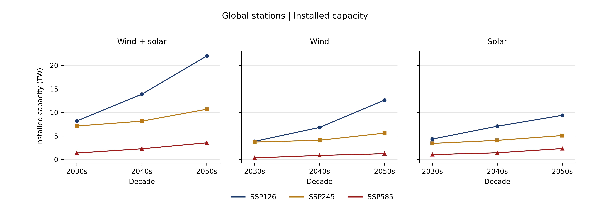

全球场站-dispatch：总装机容量（TW）

### 全球场站-LCOE

#### 图 2. 总装机量

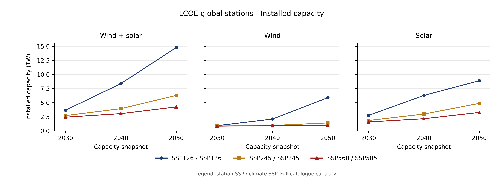

全球场站-LCOE：总装机量（TW）

### 全球场站-LCOE-2025

2015—2025为逐年GEM实际装机；2026—2029固定2025装机，2030—2059使用累计LCOE布局。容量直接汇总完整场站目录，三条彩线对应场站SSP1-2.6、SSP2-4.5、SSP5-6.0。

#### 图 3. 完整目录装机容量

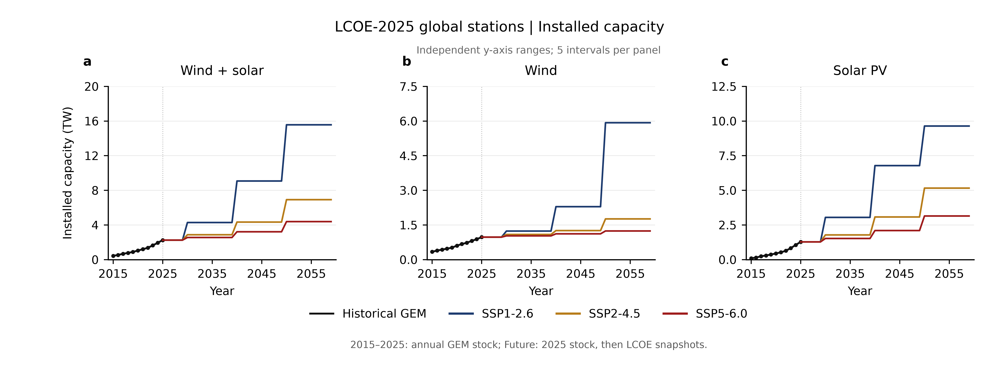

全球场站-LCOE-2025：完整目录装机容量

[完整PNG](../paper_figures/supplementary/global_metric_trends/outputs/gem2025_station_capacity.png)；独立子图：[a](../paper_figures/supplementary/global_metric_trends/outputs/gem2025_station_capacity_a.png)；[b](../paper_figures/supplementary/global_metric_trends/outputs/gem2025_station_capacity_b.png)；[c](../paper_figures/supplementary/global_metric_trends/outputs/gem2025_station_capacity_c.png)。

### 固定2025装机

2026—2059年固定2025年末实际场站位置与容量：陆风及类型未知风电0.9743 TW、光伏1.2804 TWp；历史2015—2025仍使用各年的实际装机。其他指标按共同有效场站计算，详见[数据指南第13节](BCSD_v2数据使用指南.md#lcoe-2025)。

## 极端事件（暴露时长）

### 全球网格

#### 图 4. 面积加权年均暴露时长

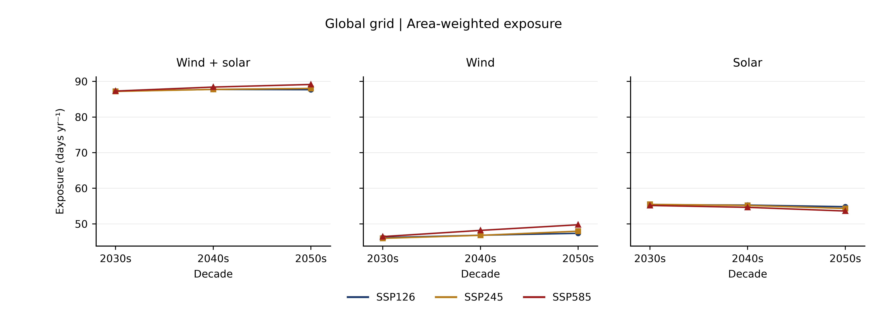

全球网格面积加权年均暴露时长（天/年）

### 全球适宜性网格

#### 图 5. 面积加权年均暴露时长

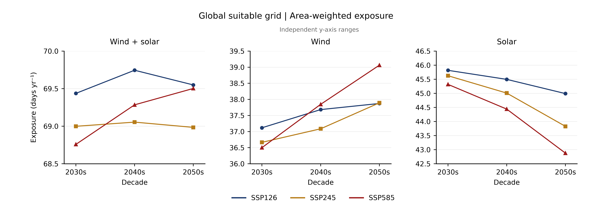

全球适宜性网格面积加权年均暴露时长（天/年）

### 全球场站-dispatch

#### 图 6. 装机容量加权暴露总量

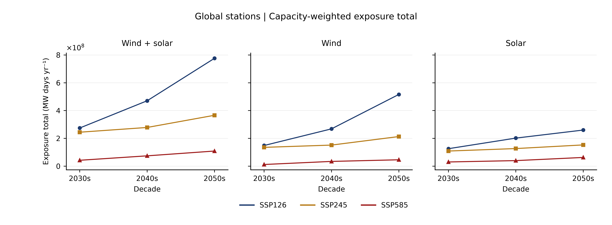

全球场站-dispatch：装机容量加权暴露总量（MW·天/年）

#### 图 7. 装机容量加权年均暴露时长

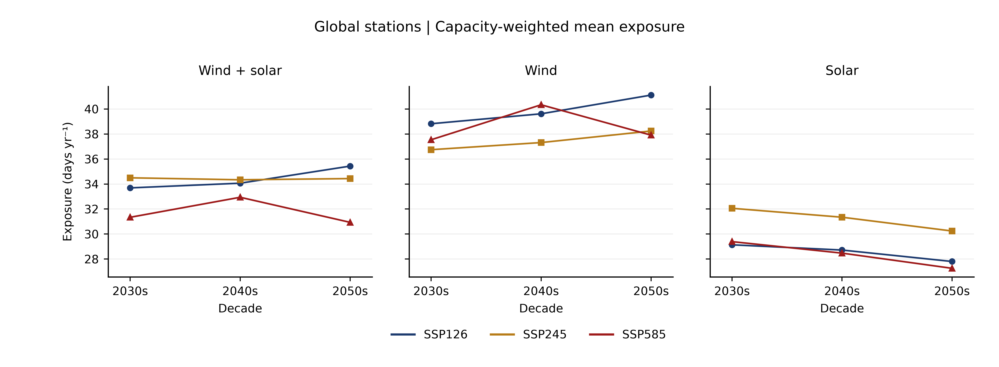

全球场站-dispatch：装机容量加权年均暴露时长（天/年）

### 全球场站-LCOE

#### 图 8. 容量加权暴露总量

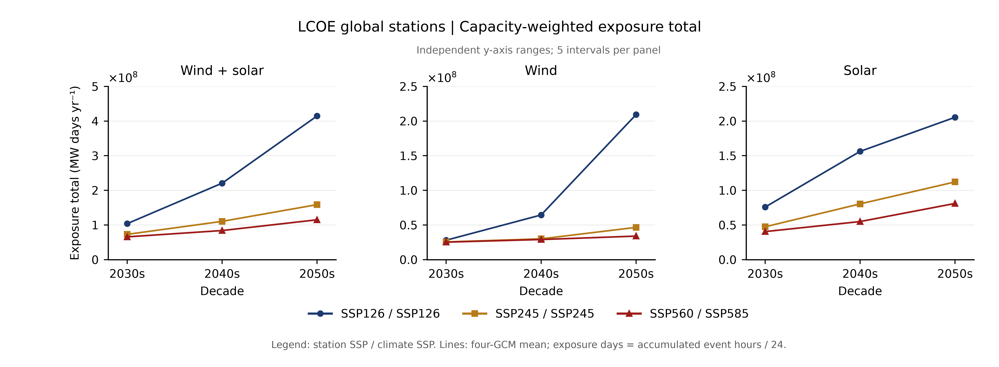

全球场站-LCOE：容量加权暴露总量（MW·天/年）

#### 图 9. 容量加权年均暴露时长

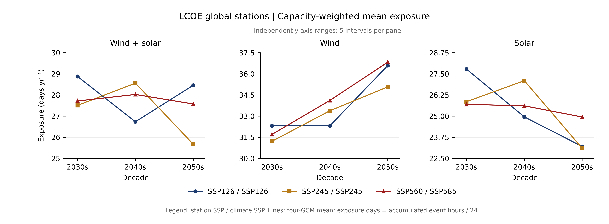

全球场站-LCOE：容量加权年均暴露时长（天/年）

### 全球场站-LCOE-2025

2015—2025为ERA5-Land与逐年GEM装机；2026—2059为四模式均值。2026—2029固定2025装机，2030—2059使用累计LCOE布局。

#### 图 10. 装机加权暴露总量

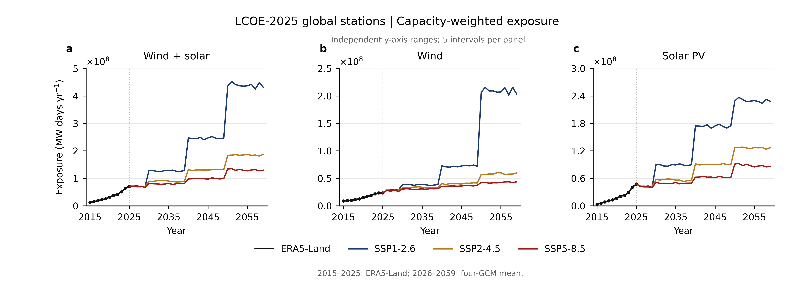

全球场站-LCOE-2025：装机加权暴露总量

[完整PNG](../paper_figures/supplementary/global_metric_trends/outputs/gem2025_station_exposure_total.png)；独立子图：[a](../paper_figures/supplementary/global_metric_trends/outputs/gem2025_station_exposure_total_a.png)；[b](../paper_figures/supplementary/global_metric_trends/outputs/gem2025_station_exposure_total_b.png)；[c](../paper_figures/supplementary/global_metric_trends/outputs/gem2025_station_exposure_total_c.png)。

#### 图 11. 装机加权平均暴露时长

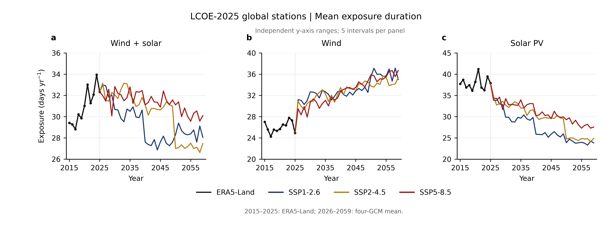

全球场站-LCOE-2025：装机加权平均暴露时长

[完整PNG](../paper_figures/supplementary/global_metric_trends/outputs/gem2025_station_exposure_mean.png)；独立子图：[a](../paper_figures/supplementary/global_metric_trends/outputs/gem2025_station_exposure_mean_a.png)；[b](../paper_figures/supplementary/global_metric_trends/outputs/gem2025_station_exposure_mean_b.png)；[c](../paper_figures/supplementary/global_metric_trends/outputs/gem2025_station_exposure_mean_c.png)。

### 固定2025装机

2015—2025为ERA5-Land与逐年GEM装机；2026—2059为四模式均值。2026—2059始终固定2025位置和容量。

#### 图 12. 装机加权暴露总量

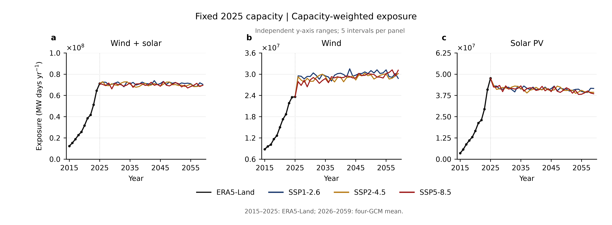

固定2025装机：装机加权暴露总量

[完整PNG](../paper_figures/supplementary/global_metric_trends/outputs/gem2025_station_fixed_exposure_total.png)；独立子图：[a](../paper_figures/supplementary/global_metric_trends/outputs/gem2025_station_fixed_exposure_total_a.png)；[b](../paper_figures/supplementary/global_metric_trends/outputs/gem2025_station_fixed_exposure_total_b.png)；[c](../paper_figures/supplementary/global_metric_trends/outputs/gem2025_station_fixed_exposure_total_c.png)。

#### 图 13. 装机加权平均暴露时长

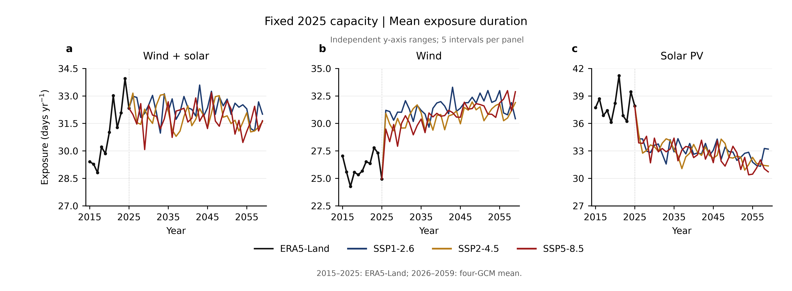

固定2025装机：装机加权平均暴露时长

[完整PNG](../paper_figures/supplementary/global_metric_trends/outputs/gem2025_station_fixed_exposure_mean.png)；独立子图：[a](../paper_figures/supplementary/global_metric_trends/outputs/gem2025_station_fixed_exposure_mean_a.png)；[b](../paper_figures/supplementary/global_metric_trends/outputs/gem2025_station_fixed_exposure_mean_b.png)；[c](../paper_figures/supplementary/global_metric_trends/outputs/gem2025_station_fixed_exposure_mean_c.png)。

## 损失

### 全球适宜性网格

#### 图 14. 单位装机净损失

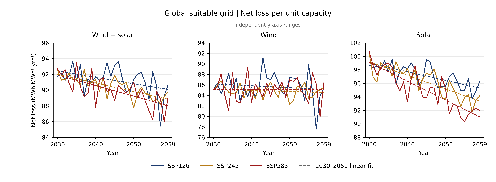

全球适宜性网格单位装机净损失（MWh/MW/年）

### 全球场站-dispatch

#### 图 15. 总净损失

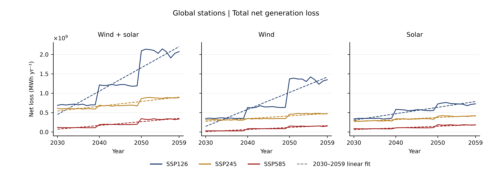

全球场站-dispatch：总净损失（MWh/年）

#### 图 16. 单位装机净损失

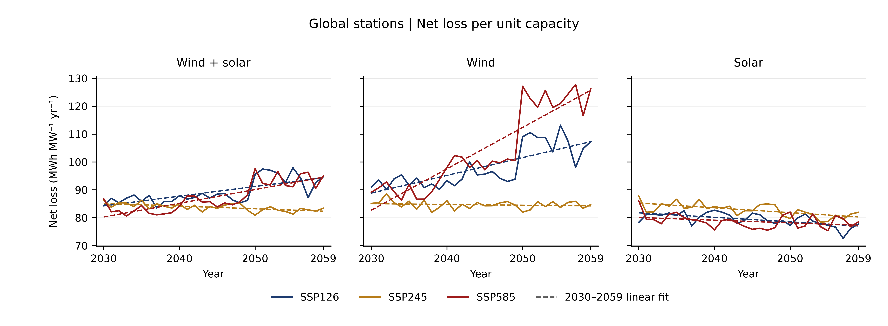

全球场站-dispatch：单位装机净损失（MWh/MW/年）

#### 图 17. 年净损失占全年正常基准电量比例

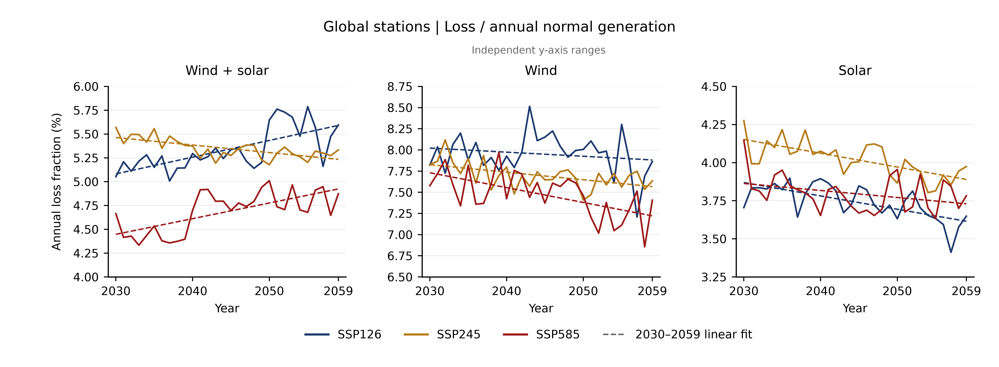

全球场站-dispatch：年净损失占全年正常基准电量比例（%）

### 全球场站-LCOE

#### 图 18. 总净损失

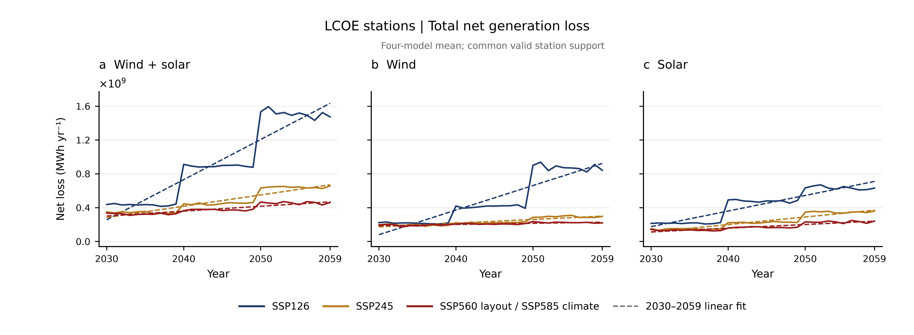

全球场站-LCOE：总净损失（MWh/年）

#### 图 19. 单位装机净损失

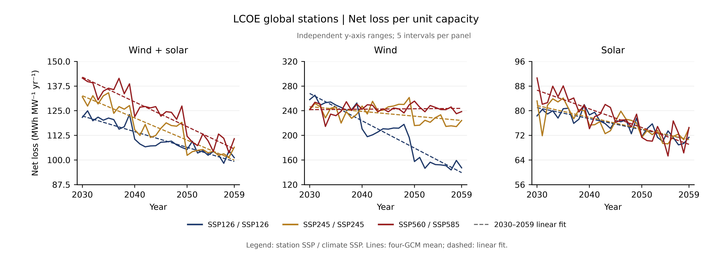

全球场站-LCOE：单位装机净损失（MWh/MW/年）

#### 图 20. 年净损失占全年正常基准电量比例

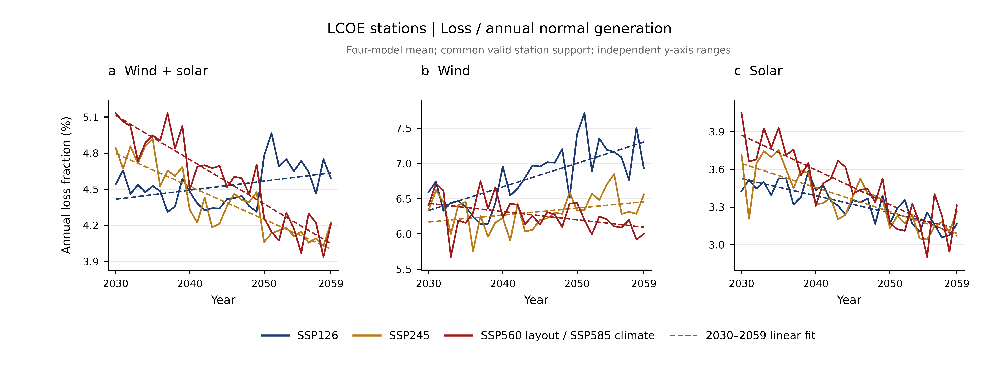

全球场站-LCOE：年净损失占全年正常基准电量比例（%）

### 全球场站-LCOE-2025

2015—2025为ERA5-Land与逐年GEM装机；2026—2059为四模式均值。2026—2029固定2025装机，2030—2059使用累计LCOE布局。

#### 图 21. 总净损失

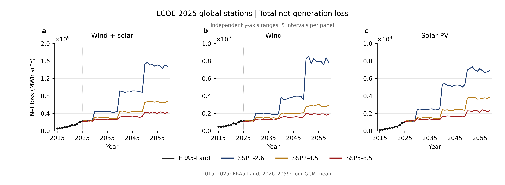

全球场站-LCOE-2025：总净损失

[完整PNG](../paper_figures/supplementary/global_metric_trends/outputs/gem2025_station_total_loss.png)；独立子图：[a](../paper_figures/supplementary/global_metric_trends/outputs/gem2025_station_total_loss_a.png)；[b](../paper_figures/supplementary/global_metric_trends/outputs/gem2025_station_total_loss_b.png)；[c](../paper_figures/supplementary/global_metric_trends/outputs/gem2025_station_total_loss_c.png)。

#### 图 22. 单位装机净损失

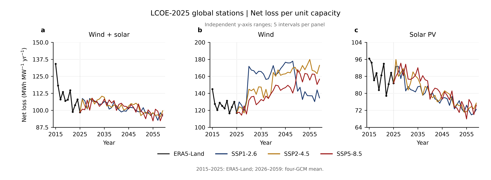

全球场站-LCOE-2025：单位装机净损失

[完整PNG](../paper_figures/supplementary/global_metric_trends/outputs/gem2025_station_unit_loss.png)；独立子图：[a](../paper_figures/supplementary/global_metric_trends/outputs/gem2025_station_unit_loss_a.png)；[b](../paper_figures/supplementary/global_metric_trends/outputs/gem2025_station_unit_loss_b.png)；[c](../paper_figures/supplementary/global_metric_trends/outputs/gem2025_station_unit_loss_c.png)。

#### 图 23. 净损失占正常基准电量比例

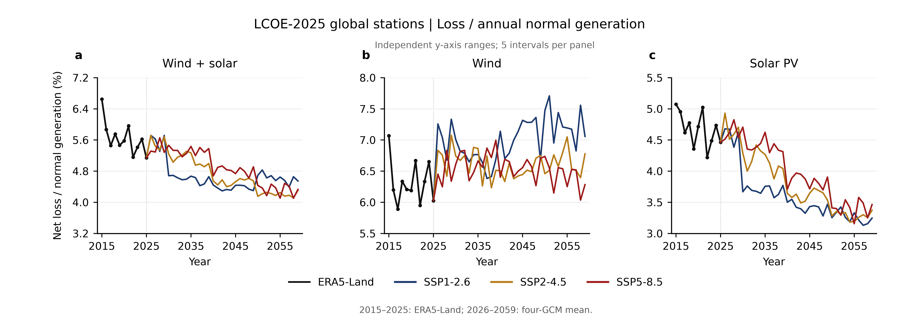

全球场站-LCOE-2025：净损失占正常基准电量比例

[完整PNG](../paper_figures/supplementary/global_metric_trends/outputs/gem2025_station_loss_fraction.png)；独立子图：[a](../paper_figures/supplementary/global_metric_trends/outputs/gem2025_station_loss_fraction_a.png)；[b](../paper_figures/supplementary/global_metric_trends/outputs/gem2025_station_loss_fraction_b.png)；[c](../paper_figures/supplementary/global_metric_trends/outputs/gem2025_station_loss_fraction_c.png)。

### 固定2025装机

2015—2025为ERA5-Land与逐年GEM装机；2026—2059为四模式均值。2026—2059始终固定2025位置和容量。

#### 图 24. 总净损失

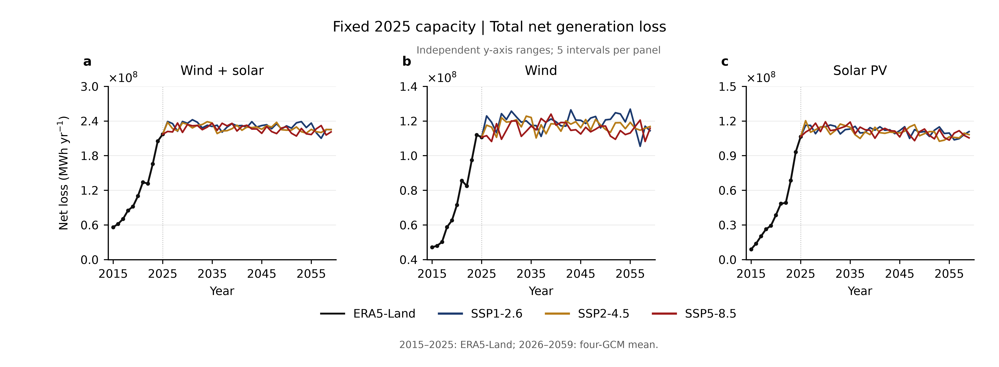

固定2025装机：总净损失

[完整PNG](../paper_figures/supplementary/global_metric_trends/outputs/gem2025_station_fixed_total_loss.png)；独立子图：[a](../paper_figures/supplementary/global_metric_trends/outputs/gem2025_station_fixed_total_loss_a.png)；[b](../paper_figures/supplementary/global_metric_trends/outputs/gem2025_station_fixed_total_loss_b.png)；[c](../paper_figures/supplementary/global_metric_trends/outputs/gem2025_station_fixed_total_loss_c.png)。

#### 图 25. 单位装机净损失

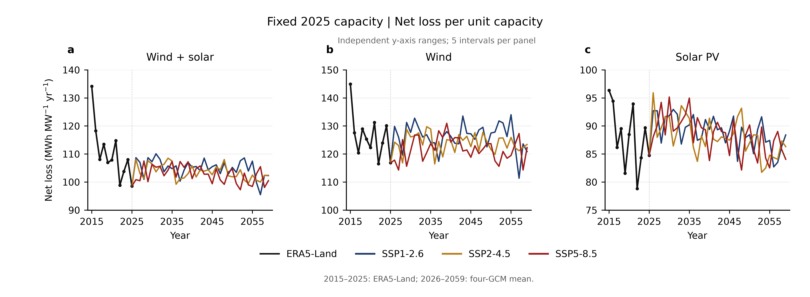

固定2025装机：单位装机净损失

[完整PNG](../paper_figures/supplementary/global_metric_trends/outputs/gem2025_station_fixed_unit_loss.png)；独立子图：[a](../paper_figures/supplementary/global_metric_trends/outputs/gem2025_station_fixed_unit_loss_a.png)；[b](../paper_figures/supplementary/global_metric_trends/outputs/gem2025_station_fixed_unit_loss_b.png)；[c](../paper_figures/supplementary/global_metric_trends/outputs/gem2025_station_fixed_unit_loss_c.png)。

#### 图 26. 净损失占正常基准电量比例

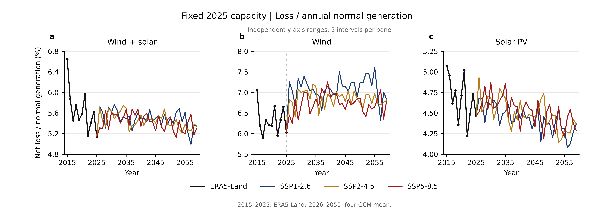

固定2025装机：净损失占正常基准电量比例

[完整PNG](../paper_figures/supplementary/global_metric_trends/outputs/gem2025_station_fixed_loss_fraction.png)；独立子图：[a](../paper_figures/supplementary/global_metric_trends/outputs/gem2025_station_fixed_loss_fraction_a.png)；[b](../paper_figures/supplementary/global_metric_trends/outputs/gem2025_station_fixed_loss_fraction_b.png)；[c](../paper_figures/supplementary/global_metric_trends/outputs/gem2025_station_fixed_loss_fraction_c.png)。

## 发电

### 全球场站-dispatch

#### 图 27. 总发电量

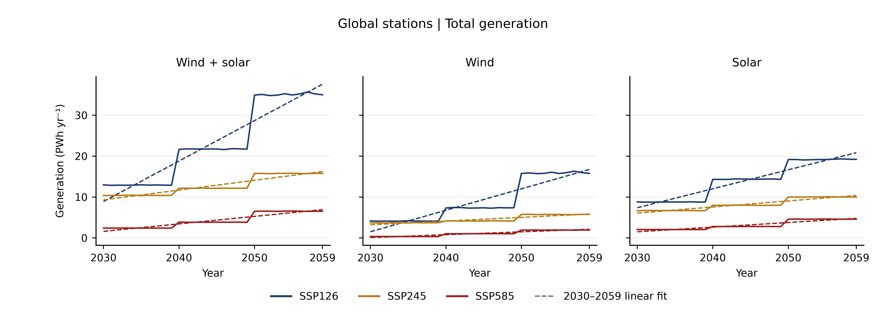

全球场站-dispatch：总发电量（PWh/年）

#### 图 28. 单位装机发电量

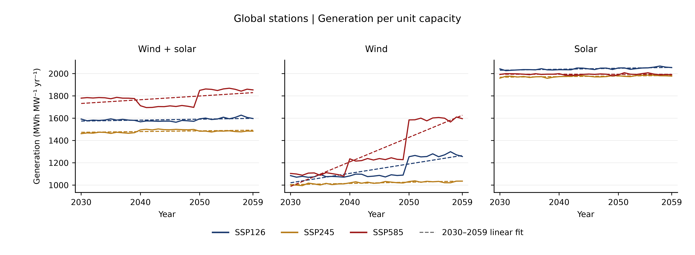

全球场站-dispatch：单位装机发电量（MWh/MW/年）

### 全球场站-LCOE

#### 图 29. 总发电量

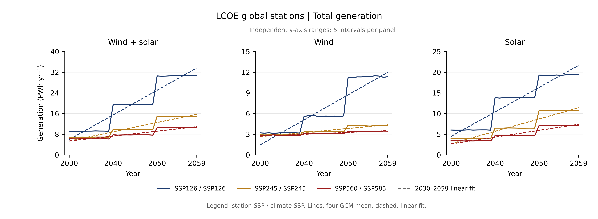

全球场站-LCOE：总发电量（PWh/年）

#### 图 30. 单位装机发电量

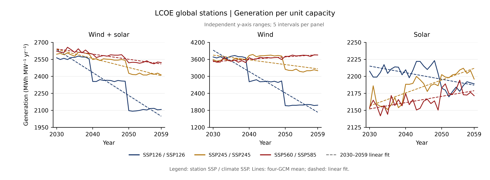

全球场站-LCOE：单位装机发电量（MWh/MW/年）

### 全球场站-LCOE-2025

2015—2025为ERA5-Land与逐年GEM装机；2026—2059为四模式均值。2026—2029固定2025装机，2030—2059使用累计LCOE布局。

#### 图 31. 全年总发电量

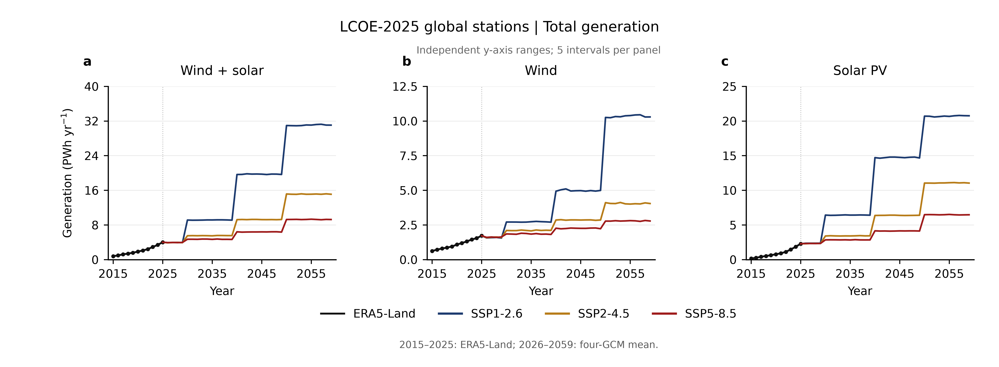

全球场站-LCOE-2025：全年总发电量

[完整PNG](../paper_figures/supplementary/global_metric_trends/outputs/gem2025_station_total_generation.png)；独立子图：[a](../paper_figures/supplementary/global_metric_trends/outputs/gem2025_station_total_generation_a.png)；[b](../paper_figures/supplementary/global_metric_trends/outputs/gem2025_station_total_generation_b.png)；[c](../paper_figures/supplementary/global_metric_trends/outputs/gem2025_station_total_generation_c.png)。

#### 图 32. 单位装机全年发电量

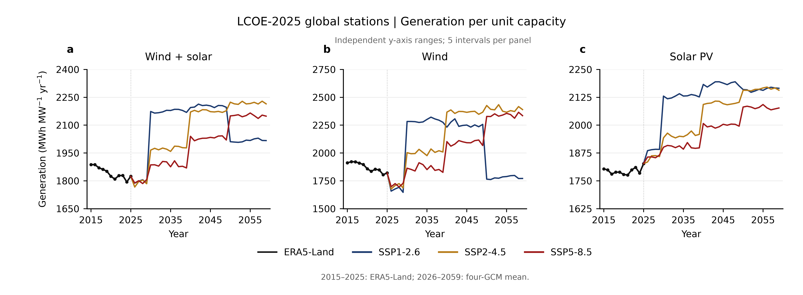

全球场站-LCOE-2025：单位装机全年发电量

[完整PNG](../paper_figures/supplementary/global_metric_trends/outputs/gem2025_station_unit_generation.png)；独立子图：[a](../paper_figures/supplementary/global_metric_trends/outputs/gem2025_station_unit_generation_a.png)；[b](../paper_figures/supplementary/global_metric_trends/outputs/gem2025_station_unit_generation_b.png)；[c](../paper_figures/supplementary/global_metric_trends/outputs/gem2025_station_unit_generation_c.png)。

#### 图 33. 容量加权全年平均CF

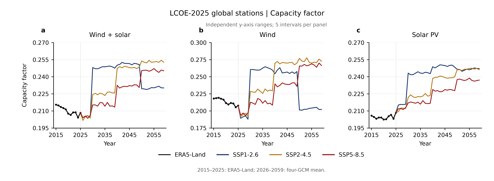

全球场站-LCOE-2025：容量加权全年平均CF

[完整PNG](../paper_figures/supplementary/global_metric_trends/outputs/gem2025_station_cf.png)；独立子图：[a](../paper_figures/supplementary/global_metric_trends/outputs/gem2025_station_cf_a.png)；[b](../paper_figures/supplementary/global_metric_trends/outputs/gem2025_station_cf_b.png)；[c](../paper_figures/supplementary/global_metric_trends/outputs/gem2025_station_cf_c.png)。

### 固定2025装机

2015—2025为ERA5-Land与逐年GEM装机；2026—2059为四模式均值。2026—2059始终固定2025位置和容量。

#### 图 34. 全年总发电量

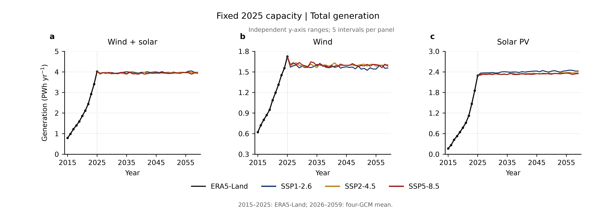

固定2025装机：全年总发电量

[完整PNG](../paper_figures/supplementary/global_metric_trends/outputs/gem2025_station_fixed_total_generation.png)；独立子图：[a](../paper_figures/supplementary/global_metric_trends/outputs/gem2025_station_fixed_total_generation_a.png)；[b](../paper_figures/supplementary/global_metric_trends/outputs/gem2025_station_fixed_total_generation_b.png)；[c](../paper_figures/supplementary/global_metric_trends/outputs/gem2025_station_fixed_total_generation_c.png)。

#### 图 35. 单位装机全年发电量

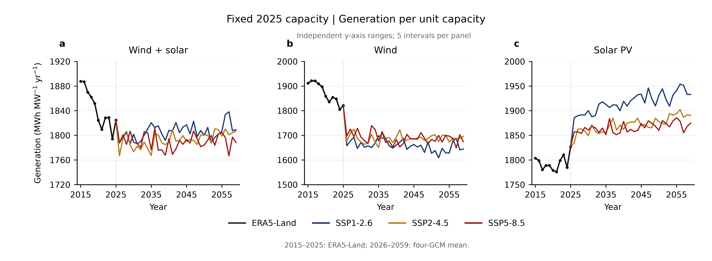

固定2025装机：单位装机全年发电量

[完整PNG](../paper_figures/supplementary/global_metric_trends/outputs/gem2025_station_fixed_unit_generation.png)；独立子图：[a](../paper_figures/supplementary/global_metric_trends/outputs/gem2025_station_fixed_unit_generation_a.png)；[b](../paper_figures/supplementary/global_metric_trends/outputs/gem2025_station_fixed_unit_generation_b.png)；[c](../paper_figures/supplementary/global_metric_trends/outputs/gem2025_station_fixed_unit_generation_c.png)。

#### 图 36. 容量加权全年平均CF

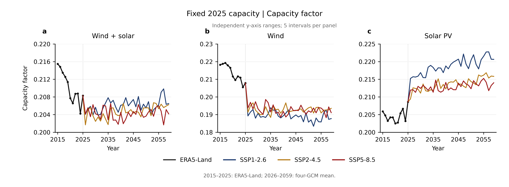

固定2025装机：容量加权全年平均CF

[完整PNG](../paper_figures/supplementary/global_metric_trends/outputs/gem2025_station_fixed_cf.png)；独立子图：[a](../paper_figures/supplementary/global_metric_trends/outputs/gem2025_station_fixed_cf_a.png)；[b](../paper_figures/supplementary/global_metric_trends/outputs/gem2025_station_fixed_cf_b.png)；[c](../paper_figures/supplementary/global_metric_trends/outputs/gem2025_station_fixed_cf_c.png)。

## 文档说明

### 数据来源与结果索引

原始指标表来源：`tmp/风电光伏数据.xlsx`。单独风电、单独光伏、风电+光伏三列的相同内容合并展示。表中 `\` 表示该口径不适用；单元格内多行表示该组合下同时产出多个指标。

计算与绘图均在乌镇1866执行。项目根目录：

`/work/home/aczlvkl1ac/project_climate_patchify/repos/analysis_of_global_pv_wind`

统一目录：`paper_figures/supplementary/global_metric_trends/`。指标总览表的 `\` 项不纳入本次计算；不是将无真实装机的网格假定为实际场站。

顶部表格中的路径均相对于1866项目根目录。

顶部结果路径表的每行对应一个完整 PNG，均为1行3列，依次为风电+光伏、单独风电、单独光伏。逐模式表包含计算分子、分母；均值表包含四模式均值、最小值、最大值及模式数。装机容量来自目录，不人为复制成四个模式。

### 网格与全球场站-dispatch：计算定义

- **装机容量**：各场站SSP在2030、2040、2050的总容量快照，统一换算为TW；不是新增容量逐年累加。图上按2030s、2040s、2050s标注。

- **网格暴露**：逐模式先计算面积加权年均暴露，再取四模式等权均值。天表示累计暴露小时除以24，不是“出现过事件的日历日数”。

- **风光合并网格暴露**：按用户选择，采用两种技术事件的时间并集，不是两个暴露均值的平均或相加。沿用既有跨技术缓存的三小时时段配对：光伏时间戳 t 与风电 t+1.5 h 配对，以光伏时段年份归年；保留五种风电、六种光伏事件标签。该口径不同于仅选十种气象事件的其他分析。

- **适宜性网格合并暴露**：两类适宜网格取空间并集，面积只计一次；仅适宜风电/光伏时取对应技术的事件并集，两者均适宜时取跨技术时间并集。共同有效支持在四模式、三SSP和2030—2059全时段上固定；不把某技术缺测降级成另一技术有效、不把缺测当作零暴露。

- **场站暴露**：设容量为 <i>Ci</i>、年度暴露天数为 <i>Di,y</i>，总量为 Σi <i>CiDi,y</i>，单位MW·天/年；平均时长为 Σi <i>CiDi,y</i> / Σi <i>Ci</i>，单位天/年。风光合并在两类技术场站集合上汇总分子、分母；并非把全球不同地点的事件压成一条时间并集。每种技术内事件仍按时间并集去重。

- **适宜性网格损失**：每个技术网格固定1 MW，净损失之和除以有效技术网格数；不使用面积权重。同一格点两种技术都适宜时，为两份各1 MW的技术对象，而不是暴露图的单份地理面积。

- **场站损失**：保留带符号净损失；总量为 Σi <i>Li,y</i>，单位装机量为 Σi <i>Li,y</i> / Σi <i>Ci</i>。百分比为 100·Σi <i>Li,y</i> / Σi <i>G</i>i,ynormal，分母是全年正常基准发电量，不是基于实际CF的全年发电量，也不是事件期电量。

- **场站发电**：<i>Gy</i> = Σi <i>Ci</i> · <i>CF̄</i>i,y · <i>Hy</i>，<i>Hy</i> 采用模式原生日历全年小时数；输入年度CF时间覆盖完整。单位装机发电量为 <i>Gy</i> / Σi <i>Ci</i>。风电能量不乘0.1。

- **有效样本与容量**：容量图使用完整目录容量；场站暴露、损失和发电使用各已验收汇总的有效样本容量，不用完整目录容量代替有效分母。结果保留容量及覆盖信息。各空间口径沿用相应共同有效支持，不声称三个面板具有完全相同的格点集合。

- **SSP路径**：场站用气候SSP与场站SSP配对；网格只有气候SSP。场站SSP585的原始部署来源为SSP5-6.0。场站年度轨迹在每个年代使用对应2030/2040/2050快照，年代边界变化包括部署改变，不解释为纯气候变化。

### 绘图、拟合与校验

原有网格、dispatch与全球场站-LCOE图从左到右依次为风电+光伏、单独风电、单独光伏。装机量与暴露时长展示三个年代点；损失与发电展示2030—2059年曲线及每个SSP的全时段线性拟合虚线。图片已以 base64 嵌入本文件。

- 装机量、暴露：仅三个年代点并连线；暴露先取每模式十年均值，再取四模式均值。

- 损失、发电：2030—2059逐年四模式均值实线；每个面板每个SSP仅拟合一条覆盖全30年的OLS虚线，不按年代分别拟合。

- 拟合采用 <i>y</i> = <i>a</i> + <i>b</i>·(year − 2030)，属于描述性趋势，不报告显著性。六张年度图共54条拟合线。

- 网格与全球场站-dispatch图中，图4、5、14、16、17、28的三个面板使用独立纵轴范围，并分别显示刻度；其余网格与全球场站-dispatch图共用纵轴范围。SSP126/245/585分别沿用深蓝、赭黄、深红。只输出完整600 dpi PNG，不导出独立子图。

- 全球场站-dispatch单位装机净损失（图16）的三个子图分别设置Y轴上下限，每个子图均为5个等距间隔、6个刻度值。

- [全部拟合系数](../paper_figures/supplementary/global_metric_trends/outputs/source_data/all_linear_fits.csv)；每张年度图另有同名 `_fits.csv`。

- [并集逐年结果](../paper_figures/supplementary/global_metric_trends/outputs/source_data/grid_union_annual.csv)、[并集年代结果](../paper_figures/supplementary/global_metric_trends/outputs/source_data/grid_union_decadal.csv)、[空间覆盖](../paper_figures/supplementary/global_metric_trends/outputs/source_data/grid_union_coverage.csv)。

- [并集校验](../paper_figures/supplementary/global_metric_trends/outputs/union_validation.json)、[指标与图件校验](../paper_figures/supplementary/global_metric_trends/outputs/validation.json)、[输入哈希](../paper_figures/supplementary/global_metric_trends/outputs/input_provenance.json)、[结果清单](../paper_figures/supplementary/global_metric_trends/outputs/results_manifest.json)、[绘图约定](../paper_figures/supplementary/global_metric_trends/outputs/figure_contract.json)。

- 执行与复现入口见[绘图目录README](../paper_figures/supplementary/global_metric_trends/README.md)。

### 网格与全球场站-dispatch：完成状态

11张完整PNG、11份逐模式表、11份绘图均值表和54条年度拟合均已完成。并集汇总作业 `48012198` 已完成（用时1分55秒）；其余指标由小型汇总表直接计算。已逐张查看全部PNG，复核总量加和、强度范围、54条OLS拟合以及1866上的全部文档链接。

[数值与视觉检查记录](../paper_figures/supplementary/global_metric_trends/outputs/visual_review.md)。11张PNG已拉取到本地，并与本文一起纳入Git；源表、脚本及校验记录保存在1866上述目录，相应链接以1866仓库为准。

### 全球场站-LCOE：损失与发电量

各子图采用独立Y轴上下限，统一5个刻度间隔（6个刻度值），分别显示数值标签。

LCOE损失与发电的五组图基于 LCOE 累计场站布局和 BCSD 数据，每组为一行三列，从左到右依次为风电+光伏、单独风电、单独光伏。实线为2030—2059年四模式均值，虚线为各路径的全时段线性拟合。

2030、2040、2050容量快照分别用于2030—2039、2040—2049、2050—2059年；SSP126/245布局匹配同名气候，SSP560布局匹配SSP585气候。各图使用共同有效场站，风光合计装机覆盖率为97.65%—98.50%，总量未外推至缺测装机。

原始评价数据来源：`globally_interconnected_10km_LCOE/results/BCSD_evaluation/`。五张完整组图均以 base64 嵌入本文件。

### 全球场站-LCOE：装机量与极端事件暴露

三张完整组图均为一行三列，依次为**风电＋光伏、陆上风电、光伏**，仅显示场站SSP／气候SSP配对路径：**126／126、245／245、560／585**。高排放路径的场站布局仍为SSP5-6.0，气候为SSP5-8.5。各子图采用独立Y轴上下限，统一5个刻度间隔（6个刻度值），分别显示数值标签。

- **总装机量（TW）**：分别汇总2030、2040、2050年完整LCOE选址目录的总容量；三个年份为累计快照，不再次相加。

- **容量加权暴露总量（MW·天/年）**：逐场站累计适用事件时间并集的暴露小时，除以24后乘以该年代容量，再全球求和。

- **容量加权年均暴露时长（天/年）**：暴露总量除以相同有效场站的容量总量。风光合计先加总两种技术的容量加权分子、分母，再相除；不将两种技术的均值直接平均。

- 暴露统计覆盖2030–2039、2040–2049、2050–2059，各窗口使用2030、2040、2050年容量快照。先计算单模式十年均值，再对四个气候模式等权平均；图中不绘制线性拟合或置信区间，模式最小／最大值保留在源数据表。

- 风电使用5类、光伏使用6类正式事件的**时间并集**，不累加重叠事件。1天表示24小时累计暴露，不是发生事件的日历天数。保留原生日历，缺测不作无事件，也不外推缺失时段。

- 沿用原文档场站暴露图的有效性口径：采用配对Loss产品的四模式、30年共同有效场站集合，并核验各站点每年事件有效时间至少99%。本批最低时间覆盖率为100.0000%；风光合计有效容量占完整目录的97.65%–98.50%。完整装机量图不作此筛选，暴露图也不放大至完整目录容量。

数据入口为[BCSD数据指南第12节](BCSD_v2数据使用指南.md)中1959共享目录的Extreme正式索引；容量与共同有效集合按第11节配对Loss档案核对。配对路径差同时包含气候、部署与容量权重变化。

新增代码与原图代码同目录：[数据汇总](../paper_figures/supplementary/global_metric_trends/prepare_lcoe.py)、[绘图及文档更新](../paper_figures/supplementary/global_metric_trends/plot_lcoe.py)，各有同名SLURM脚本。源数据为该目录outputs/source_data下的lcoe_station_capacity、lcoe_station_exposure_annual_models、lcoe_station_exposure_decadal_models及lcoe_station_exposure_coverage等CSV；输入索引摘要、时间完整性与覆盖校验记录在outputs/lcoe_exposure_validation.json。

### 全球场站-LCOE-2025与固定2025装机：数据及绘图

两组新增图使用GEM 2026年2月版场站数据与修正后的适宜性格点；仅保留陆上及类型未知风电，光伏容量为MWp/DC。历史采用允许退出与容量变化的historical_snapshot逐年资料。2025只代表2025年。

- 2015—2025黑线：ERA5-Land逐小时气候与当年年末实际装机。容量按全年应用，未按年内投运月份折算；发电量是气候驱动估算。

- 全球场站-LCOE-2025彩线：2026—2029固定2025装机；2030—2059使用2030、2040、2050累计快照。场站/气候配对为126/126、245/245、560/585。三条气候路径分别按四模式等权平均。

- 固定2025装机彩线：2026—2059全部采用GEM2025位置与容量；未来逐站能量先除以档案当年容量，再乘2025容量。过渡与未来档案的共同支持集交集在各路径内跨年固定。

- 装机容量图直接汇总完整场站目录，使用场站SSP标签；其他指标使用共同有效场站，并对四个气候模式等权平均。

- 两组图各自的彩线从历史2025端点接出；2026—2059数值未平移。逐年画线，不添加趋势拟合。模式最小/最大值保留在源表，不作为置信区间。

- Loss正常CF分别按2015—2025、2026—2029及三个未来十年窗口，在各气候路径内排除事件并集后估计。净损失衡量相对同期正常状态的事件偏离，保留符号；风电能量不乘0.1。

- 暴露按每种技术的事件时间并集去重。风光合计先加总容量加权分子、分母，再求比值；CF为有效容量加权全年平均，全年发电量保留各模式原生日历。

- 各面板纵轴独立，均为5个等距间隔、6个刻度。原图的1×3布局、字体、SSP配色、浅灰水平网格线与底部图例延续使用；子图从左至右为风光合计、风电、光伏。

- 共新增17张完整组图和51张独立子图，均为600 dpi PNG。完整图以base64嵌入HTML，Markdown及独立子图通过相对路径引用相同PNG。

正式数据及读取示例：[数据指南第13节](BCSD_v2数据使用指南.md#lcoe-2025)； 原始评价报告：[GEM场站历史与LCOE未来气候评价](GEM场站历史与LCOE未来气候评价.md)。

同目录代码：[两组图绘制](../paper_figures/supplementary/global_metric_trends/plot_gem2025.py)、 [HTML与Markdown整理](../paper_figures/supplementary/global_metric_trends/update_gem2025_documents.py)，各有同名SLURM脚本。 [图件、源表与数值一致性记录](../paper_figures/supplementary/global_metric_trends/outputs/gem2025_figure_manifest.json)。
